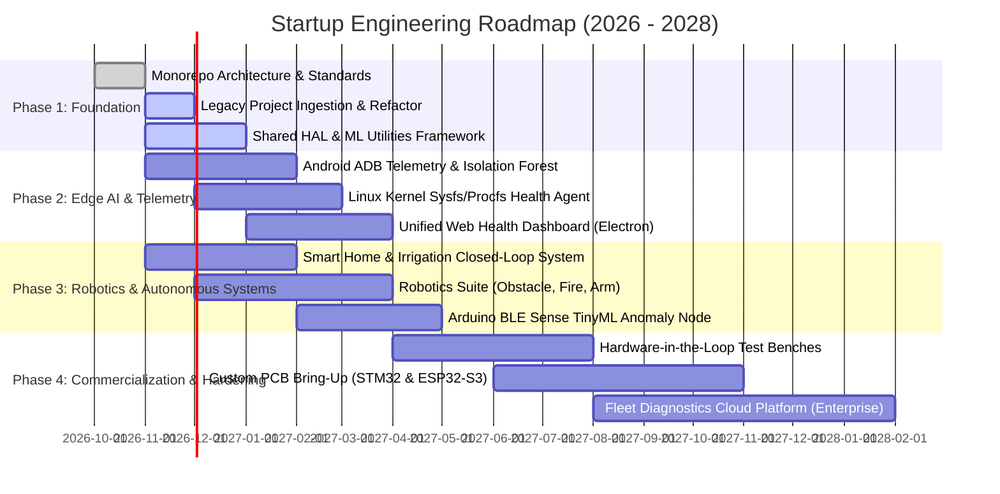

# Startup Engineering Development Roadmap

**Organization:** Kernelwise Labs / Startup Engineering Monorepo  
**Maintainer:** Aravind Reddy ([@DAravindReddy](https://github.com/DAravindReddy))  
**Horizon:** 2026 – 2028  

---

## 1. High-Level Engineering Milestones

---

## 2. Project-by-Project Development Track

### Track A: Automotive & Transportation Safety
* **`Car_black_box` (PIC16F877A / ARM Cortex-M):**
  * *Milestone 1 (Current):* Complete peripheral drivers (DS1307 RTC, 24C02 EEPROM, CLCD, ADC, UART, Keypad) and event state machine.
  * *Milestone 2:* Port logic to 32-bit ARM Cortex-M (STM32F4) using STM32 HAL and FreeRTOS.
  * *Milestone 3:* Integrate CAN bus transceiver (MCP2515 / onboard CAN) for direct OBD-II vehicle telemetry logging.
* **`smart_railway_system`:**
  * *Milestone 1 (Current):* Arduino-based ultrasonic track obstacle and IR crack detection with audio-visual alarm.
  * *Milestone 2:* LoRa / GSM long-range emergency telemetry transmitter for train dispatchers.
  * *Milestone 3:* Computer-vision track anomaly verification via onboard ESP32-CAM.

### Track B: Predictive Telemetry & Edge AI
* **`android_device_health_prediction`:**
  * *Milestone 1 (Current):* Python-based ADB telemetry collector with real-time parsing of CPU, memory, thermal, and battery metrics.
  * *Milestone 2:* Isolation Forest anomaly detection engine trained on multi-variate load profiles with adaptive risk scoring.
  * *Milestone 3:* Embedded Android APK background service (`AndroidAgent.kt`) publishing telemetry directly via MQTT / gRPC.
* **`linux_device_health_prediction`:**
  * *Milestone 1 (Current):* Userspace `/proc` and `/sys` telemetry collector for CPU load, thermal zones, memory pressure, and I/O.
  * *Milestone 2:* Integration with eBPF / tracepoints for low-overhead kernel event tracing.
  * *Milestone 3:* Native C++ inference engine loading quantized ONNX / TFLite anomaly models without external Python dependencies.

### Track C: Smart Automation & Robotics
* **`smart_home_automation` & `smart_garden_irrigation`:**
  * *Milestone 1 (Current):* Modular Arduino UNO architecture with Bluetooth HC-05 control, DHT11 environmental sensing, L298N motor drivers, servo dampers, and closed-loop soil moisture irrigation.
  * *Milestone 2:* Dual-mode automated scheduler with hysteresis logic to prevent pump cycling.
  * *Milestone 3:* Migration to ESP32 with Matter protocol and local Home Assistant integration.
* **Robotics Suite (`object_avoiding_robot`, `fire_fighting_robot`, `gesture_controlled_robotic_arm`):**
  * *Milestone 1 (Current):* Autonomous sensor-driven algorithms with dedicated pinouts, PWM speed control, and state machines.
  * *Milestone 2:* ROS 2 (Robot Operating System) micro-nodes running on FreeRTOS / ESP32.
  * *Milestone 3:* Inverse kinematics solver for the 5-DOF robotic arm with trajectory smoothing.

### Track D: TinyML & Edge Sensors
* **`arduino_ble_sense_ai`:**
  * *Milestone 1 (Current):* Sensor acquisition pipeline for 6-axis IMU (LSM9DS1 / BMI270) and temperature/humidity.
  * *Milestone 2:* TensorFlow Lite for Microcontrollers (TFLite Micro) pipeline for real-time vibration and motion anomaly detection.
  * *Milestone 3:* BLE GATT service exposing real-time anomaly scores to Android / Linux central supervisors.
