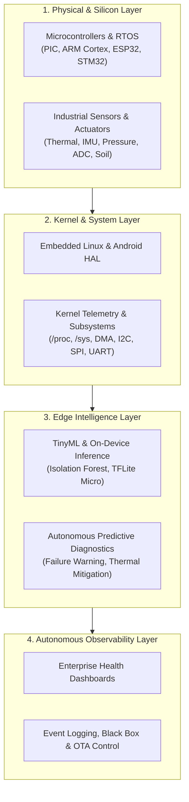
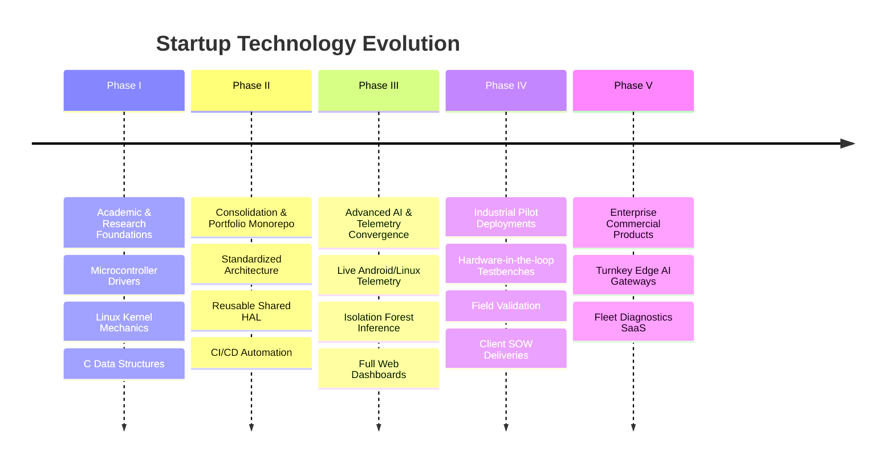

# Startup Vision & Core Philosophy

**Organization:** Kernelwise Labs / Startup Engineering Monorepo  
**Founder & Chief Engineer:** Aravind Reddy ([@DAravindReddy](https://github.com/DAravindReddy))  
**Domain:** Intelligent Embedded Systems, Linux Edge Compute, Industrial IoT, and Predictive Telemetry AI  

---

## 1. The Core Vision

Modern intelligent systems suffer from a widening architectural chasm:
- **Low-level hardware and firmware** operate in isolation, lacking predictive diagnostics, real-time observability, and automated self-healing.
- **High-level machine learning and cloud pipelines** operate divorced from real silicon constraints, suffering from high latency, excessive power draw, and catastrophic unreliability at the edge.

Our mission is to engineer **unified hardware-to-cloud intelligence**: building deeply optimized embedded firmware, bare-metal Linux drivers, low-overhead system telemetry, and ultra-efficient on-device Machine Learning models that transform physical machines and edge devices into autonomous, self-monitoring systems.

---

## 2. Strategic Pillars

### Pillar I: Zero-Compromise Low-Level Reliability
Software running on bare metal or in the Linux kernel cannot crash. We enforce strict static analysis, zero-memory-leak mandates, deterministic execution loops, non-blocking asynchronous state machines, and rigorous hardware-in-the-loop validation.

### Pillar II: Autonomous On-Device Anomaly Detection
Cloud-dependent diagnostics are too slow, bandwidth-heavy, and fragile for critical infrastructure, vehicles, and robotics. We design autonomous anomaly detection (Isolation Forests, feature vector transformations, TinyML) that runs directly on device silicon, diagnosing hardware degradation and OS instability in microseconds.

### Pillar III: Universal Observability & Black Box Telemetry
Whether monitoring an automotive powertrain via PIC microcontroller EEPROM, an Android kiosk running remote payment systems, or a Linux edge cluster, telemetry must be rich, structured, and auditable. Every system we build has black-box timestamped event recording and structured diagnostic metrics.

### Pillar IV: Reusability and Industrial Modularity
We reject throwaway prototypes. Every driver, protocol packet parser, sensor wrapper, and ML inference block is engineered as a decoupled, testable shared library with comprehensive architectural documentation, allowing rapid assembly of enterprise-grade solutions.

---

## 3. Product & Technology Portfolio Alignment

1. **Automotive & Transportation Safety:**
   - Automotive Event Telemetry & Incident Reconstruction (`Car_black_box`).
   - Track defect and vibration anomaly detection (`smart_railway_system`).
2. **Intelligent Edge Infrastructure & Health:**
   - Android Fleet Telemetry & Predictive Failure AI (`android_device_health_prediction`).
   - Linux Kernel Telemetry & Subsystem Anomaly Predictor (`linux_device_health_prediction`).
3. **Robotics & Autonomous Actuation:**
   - Obstacle Avoidance, Emergency Flame Extinguishing, and 5-DOF Kinematic Robotic Arms.
4. **Smart Environmental & Industrial Automation:**
   - Closed-loop Bluetooth & IoT environmental control (`smart_home_automation`, `smart_garden_irrigation`).
   - Onboard Edge ML Predictive Sensing (`arduino_ble_sense_ai`).

---

## 4. Path to Commercialization

Our technology roadmap is grounded in a progression from proven laboratory prototypes to field-deployable commercial systems:

