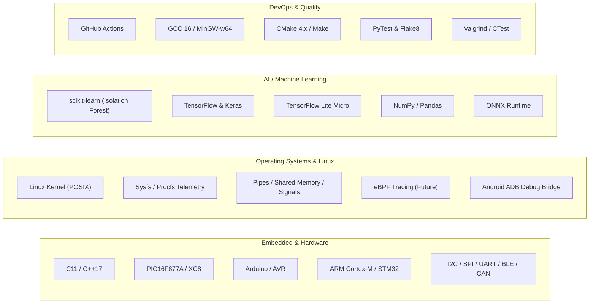

# Startup Engineering Technology Stack

**Organization:** Kernelwise Labs / Startup Engineering Monorepo  
**Author:** Aravind Reddy ([@DAravindReddy](https://github.com/DAravindReddy))  

---

## 1. Architectural Stack Matrix

---

## 2. Detailed Toolchain & Component Specifications

### 2.1 Silicon & Embedded Hardware
- **Microcontrollers:**
  - Microchip PIC16F877A (8-bit Harvard RISC, 20 MHz, 8KB Flash, 368 Bytes RAM).
  - Microchip ATmega328P / Arduino UNO (8-bit AVR, 16 MHz, 32KB Flash, 2KB SRAM).
  - Arduino Nano 33 BLE Sense (Nordic nRF52840, 32-bit ARM Cortex-M4F, 64 MHz, 1MB Flash, 256KB RAM).
  - STMicroelectronics STM32F401 / STM32F411 (Target 32-bit ARM Cortex-M4).
- **Sensors & Actuators:**
  - DHT11 / DHT22 (Digital Temperature & Relative Humidity).
  - DS1307 (I2C Real-Time Clock with battery-backed NVRAM).
  - AT24C02 / 24C04 (I2C 2-Kbit Non-Volatile Serial EEPROM).
  - HC-SR04 (Ultrasonic Time-of-Flight Distance Sensor).
  - MPU6050 / LSM9DS1 (6-DOF / 9-DOF Inertial Measurement Units).
  - Resistive / Capacitive Soil Moisture Sensors (Analog ADC interface).
  - Infrared Flame Sensors (Digital comparator & analog photodiode).
  - L298N / TB6612FNG (Dual H-Bridge Motor Drivers).
  - SG90 / MG996R (Micro and High-Torque Servo Actuators).
  - 16x2 Character LCD (HD44780 controller via 4-bit / 8-bit parallel or I2C PCF8574).

### 2.2 Embedded Software & Toolchains
- **C/C++ Compilers:** GCC 16.1.0 (MinGW-w64), Microchip MPLAB XC8 v2.4+, AVR-GCC.
- **Build Systems:** CMake 4.3+, GNU Make 4.x.
- **Embedded Libraries:**
  - Standard C Library (newlib / glibc / avr-libc).
  - Custom Hardware Abstraction Layer (`08_SHARED_LIBRARIES/`).
  - TensorFlow Lite Micro (for ARM Cortex-M4F).

### 2.3 Operating Systems & System Programming
- **Target OS Environments:** Ubuntu 22.04 / 24.04 LTS, Debian Embedded, Android 11–14 (AOSP), Windows 11 (Development host).
- **Core System Interfaces:**
  - Linux POSIX System Calls (`fork`, `execvp`, `waitpid`, `pipe`, `dup2`, `sigaction`, `shmget`).
  - Virtual Filesystems: `/proc/stat`, `/proc/meminfo`, `/sys/class/thermal/`, `/sys/class/power_supply/`.
  - Android Subsystems: Android Debug Bridge (ADB), `dumpsys battery`, `dumpsys meminfo`, `dumpsys cpuinfo`.

### 2.4 Data Science & Machine Learning
- **Frameworks:** Python 3.12, scikit-learn 1.4+, NumPy 1.26+, Pandas 2.2+.
- **Core Algorithms:**
  - Isolation Forest (Unsupervised tree ensemble for multivariate anomaly isolation).
  - Moving-window Z-Score and rolling variance normalizers.
  - Mahalanobis Distance for multi-metric covariance risk scoring.
- **Model Serialization:** Joblib, Protocol Buffers, FlatBuffers, Quantized C-arrays (`model_data.h`).

### 2.5 Observability, Dashboards & DevOps
- **Observability Stack:** Custom HTML5 / CSS3 / JavaScript Glassmorphism Dashboard, Chart.js, PowerShell HTTP Server, Python Flask/FastAPI REST backends.
- **Continuous Integration:** GitHub Actions, Git Flow, Semantic Versioning, Conventional Commits.
