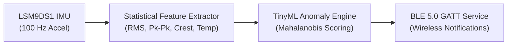

# Arduino Nano 33 BLE Sense Machine Health AI

[](LICENSE)
[](PROJECT_STATUS.md)
[](hardware/components_list.md)
[](tests/)

An ultra-low-power, on-device TinyML predictive maintenance node deployed on the Nordic Semiconductor nRF52840 ARM Cortex-M4F microcontroller (Arduino Nano 33 BLE Sense).

By coupling high-frequency 100 Hz 3-axis accelerometer vibration sampling with rolling-window statistical feature extraction (RMS, peak-to-peak amplitude, and crest factor), on-device unsupervised Gaussian anomaly inference, and a Bluetooth Low Energy (BLE 5.0) GATT telemetry service, the node detects early mechanical bearing defects, rotor unbalance, and thermal overheating within a 15-milliwatt power envelope.

---

## Architecture Overview



---

## Directory Structure

```text
arduino_ble_sense_ai/
├── README.md                          # Project overview and quickstart
├── PROJECT_STATUS.md                  # Lifecycle status and verification matrix
├── LICENSE                            # MIT License
├── .gitignore                         # Build and binary ignores
│
├── source_code/                       # Modular C/C++ firmware
│   ├── include/                       # Header interfaces
│   │   ├── config.h                   # BLE UUIDs, sampling rates, fault thresholds
│   │   ├── sensor_manager.h           # LSM9DS1 and HTS221 driver wrappers
│   │   ├── feature_extractor.h        # 64-sample ring buffer & statistical calculator
│   │   ├── tinyml_anomaly_detector.h  # Mahalanobis distance & continuous scoring
│   │   └── ble_telemetry_service.h    # ArduinoBLE GATT service & notification handlers
│   ├── src/                           # Implementation files
│   │   ├── sensor_manager.cpp
│   │   ├── feature_extractor.cpp
│   │   ├── tinyml_anomaly_detector.cpp
│   │   └── ble_telemetry_service.cpp
│   └── main/                          # Main Arduino sketch
│       └── arduino_ble_sense_ai.ino   # Multi-rate non-blocking scheduler
│
├── hardware/                          # Electrical and mechanical documentation
│   ├── components_list.md             # Complete BOM and power budget
│   ├── pin_configuration.md           # MCU pinout mapping table
│   ├── hardware_connections.md        # Physical mounting and sensor alignment
│   └── circuit_diagram/
│       └── circuit_schematic.md       # Schematic flow diagram
│
├── architecture/                      # Architectural diagrams and models
│   ├── system_architecture.md         # Signal conditioning & TinyML pipeline
│   └── block_diagram.md               # Hardware block interconnects
│
├── documentation/                     # Technical and operations manuals
│   ├── technical_documentation.md     # Vibration mathematics & BLE GATT spec
│   ├── functional_requirements.md     # Engineering requirements specification
│   └── installation_guide.md          # Firmware upload and troubleshooting
│
├── whitepaper/                        # IEEE formal research publication
│   └── whitepaper.md                  # Full 13-section research whitepaper
│
└── tests/                             # Unit testing suite
    └── unit_tests/
        └── test_tinyml_pipeline.cpp   # Standalone desktop C++ unit test runner
```

---

## Quickstart

### 1. Compile and Run Desktop Unit Tests
```bash
g++ -Wall -Wextra -Werror -pedantic -std=c++14 -I source_code/include source_code/src/*.cpp tests/unit_tests/test_tinyml_pipeline.cpp -o test_tinyml.exe
./test_tinyml.exe
```

### 2. Upload to Arduino Nano 33 BLE Sense
Open `source_code/main/arduino_ble_sense_ai.ino` in Arduino IDE, select **Arduino Nano 33 BLE**, and click **Upload**.

---

## Maintainer
**Aravind Reddy**  
Founder & Lead Engineer, Kernelwise Labs  
GitHub: [@DAravindReddy](https://github.com/DAravindReddy)
