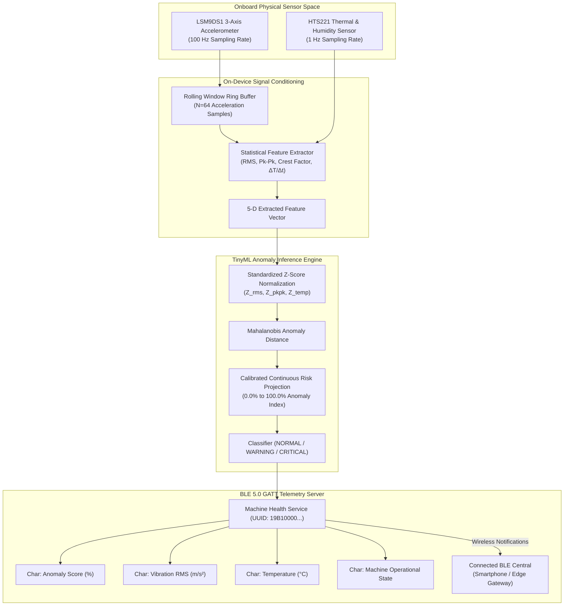

# Arduino Nano 33 BLE Sense AI - System Architecture

## 1. Architectural Overview

The Arduino Nano 33 BLE Sense Machine Health AI is an autonomous, on-device TinyML predictive maintenance node. It executes real-time sensor sampling, rolling-window statistical feature engineering, on-device anomaly scoring, and Bluetooth Low Energy (BLE) GATT telemetry streaming directly on the ARM Cortex-M4F microcontroller.

---

## 2. Mathematical Pipeline Formulation

$$\text{RMS}_{\text{vibe}} = \sqrt{\frac{1}{N} \sum_{i=1}^N \left(a_i - \bar{a}\right)^2}$$

$$d^2 = 1.5 \left(\frac{\text{RMS} - \mu_{\text{RMS}}}{\sigma_{\text{RMS}}}\right)^2 + 0.8 \left(\frac{A_{\text{pk}} - \mu_{\text{pk}}}{\sigma_{\text{pk}}}\right)^2 + 1.2 \left(\frac{T - \mu_T}{\sigma_T}\right)^2$$

$$\text{Score}_{\text{anomaly}} = \frac{100.0}{1 + e^{-0.45(d^2 - 6.0)}}\quad [\%]$$
