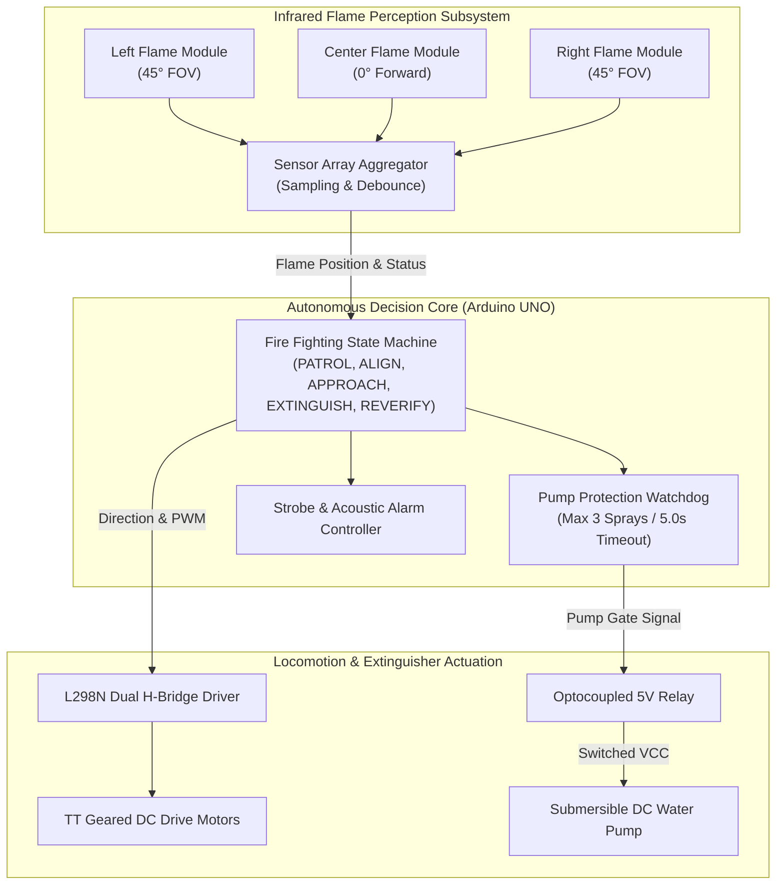
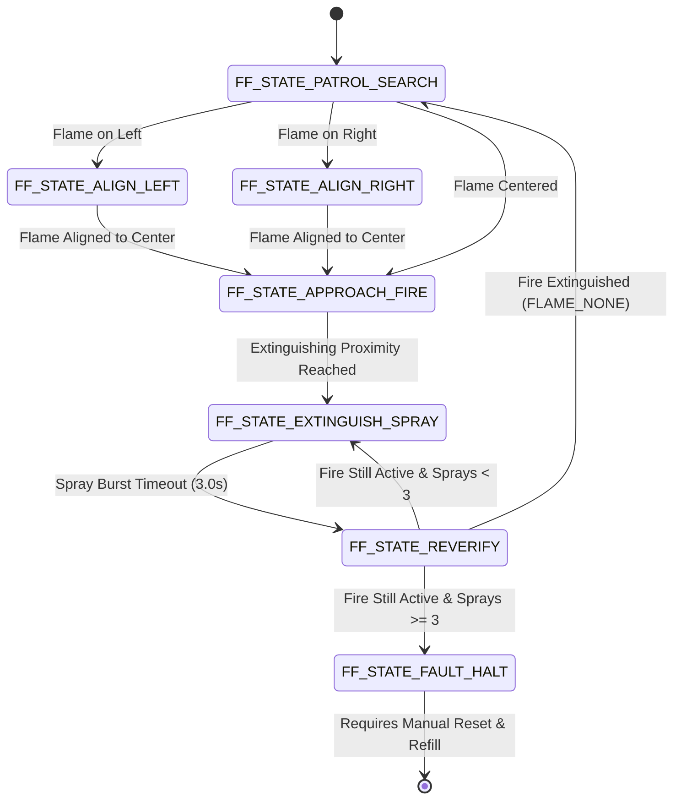

# Fire Fighting Robot - System Architecture

## 1. Architectural Overview

The Autonomous Fire Fighting Robot operates on a hierarchical, event-driven control loop. The perception pipeline continuously polls the 3-channel optical flame sensor array, the decision core calculates angular heading adjustments, and the actuation layer commands differential wheel motors and high-pressure extinguishing relays.

---

## 2. Navigation & Extinguishing State Automaton

