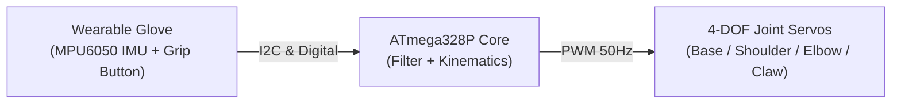

# Gesture Controlled 4-DOF Robotic Arm

[](LICENSE)
[](PROJECT_STATUS.md)
[](hardware/components_list.md)
[](tests/)

An intuitive, teleoperated 4-degree-of-freedom (4-DOF) articulated robotic manipulator that translates natural human hand gestures into synchronized multi-axis robotic movements in real time.

By coupling a wearable MPU6050 6-axis Inertial Measurement Unit (IMU) with a digital complementary orientation filter ($\alpha = 0.96$), kinematic coordinate mapping, and an automated joint velocity slew-rate limiter ($\le 90^\circ/\text{s}$), the system delivers smooth, jerk-free trajectory following while protecting servo gearboxes from mechanical shock and excessive current transients.

---

## Architecture Overview



---

## Directory Structure

```text
gesture_controlled_robotic_arm/
├── README.md                          # Project overview and quickstart
├── PROJECT_STATUS.md                  # Lifecycle status and verification matrix
├── LICENSE                            # MIT License
├── .gitignore                         # Build and binary ignores
│
├── source_code/                       # Modular C/C++ firmware
│   ├── include/                       # Header interfaces
│   │   ├── config.h                   # Pin definitions, joint limits, and slew rates
│   │   ├── mpu6050_imu.h              # 6-axis IMU driver & complementary filter
│   │   ├── servo_controller.h         # 4-DOF servo management with slew-rate profiler
│   │   └── kinematics_mapper.h        # Gesture-to-joint coordinate mapping
│   ├── src/                           # Implementation files
│   │   ├── mpu6050_imu.cpp
│   │   ├── servo_controller.cpp
│   │   └── kinematics_mapper.cpp
│   └── main/                          # Main Arduino sketch
│       └── gesture_controlled_robotic_arm.ino # 50 Hz non-blocking control loop
│
├── hardware/                          # Electrical and mechanical documentation
│   ├── components_list.md             # Complete BOM and power budget
│   ├── pin_configuration.md           # MCU pinout mapping table
│   ├── hardware_connections.md        # Physical wiring and assembly guide
│   └── circuit_diagram/
│       └── circuit_schematic.md       # Schematic flow diagram
│
├── architecture/                      # Architectural diagrams and models
│   ├── system_architecture.md         # Signal conditioning & joint hierarchy
│   └── block_diagram.md               # Hardware block interconnects
│
├── documentation/                     # Technical and operations manuals
│   ├── technical_documentation.md     # Complementary filter & slew kinematics
│   ├── functional_requirements.md     # Engineering requirements specification
│   └── installation_guide.md          # Firmware upload and troubleshooting
│
├── whitepaper/                        # IEEE formal research publication
│   └── whitepaper.md                  # Full 13-section research whitepaper
│
└── tests/                             # Unit testing suite
    └── unit_tests/
        └── test_kinematics_mapper.cpp # Standalone desktop C++ unit test runner
```

---

## Quickstart

### 1. Compile and Run Desktop Unit Tests
```bash
g++ -Wall -Wextra -Werror -pedantic -std=c++14 -I source_code/include source_code/src/*.cpp tests/unit_tests/test_kinematics_mapper.cpp -o test_arm.exe
./test_arm.exe
```

### 2. Upload to Arduino UNO / Nano
Open `source_code/main/gesture_controlled_robotic_arm.ino` in Arduino IDE, select your board, and click **Upload**.

---

## Maintainer
**Aravind Reddy**  
Founder & Lead Engineer, Kernelwise Labs  
GitHub: [@DAravindReddy](https://github.com/DAravindReddy)
