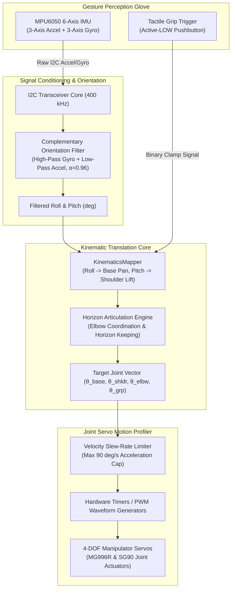
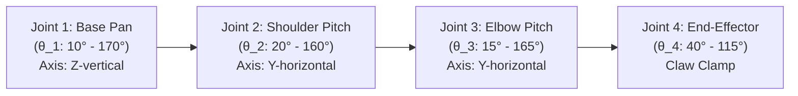

# Gesture Controlled Robotic Arm - System Architecture

## 1. Architectural Overview

The Gesture Controlled 4-DOF Robotic Arm architecture maps continuous human hand gesture dynamics into multi-axis robotic manipulator poses. The pipeline integrates 6-axis inertial perception, complementary orientation filtering, spatial coordinate mapping, and velocity-limited joint actuation.

---

## 2. 4-DOF Manipulator Kinematic Joint Formulation

