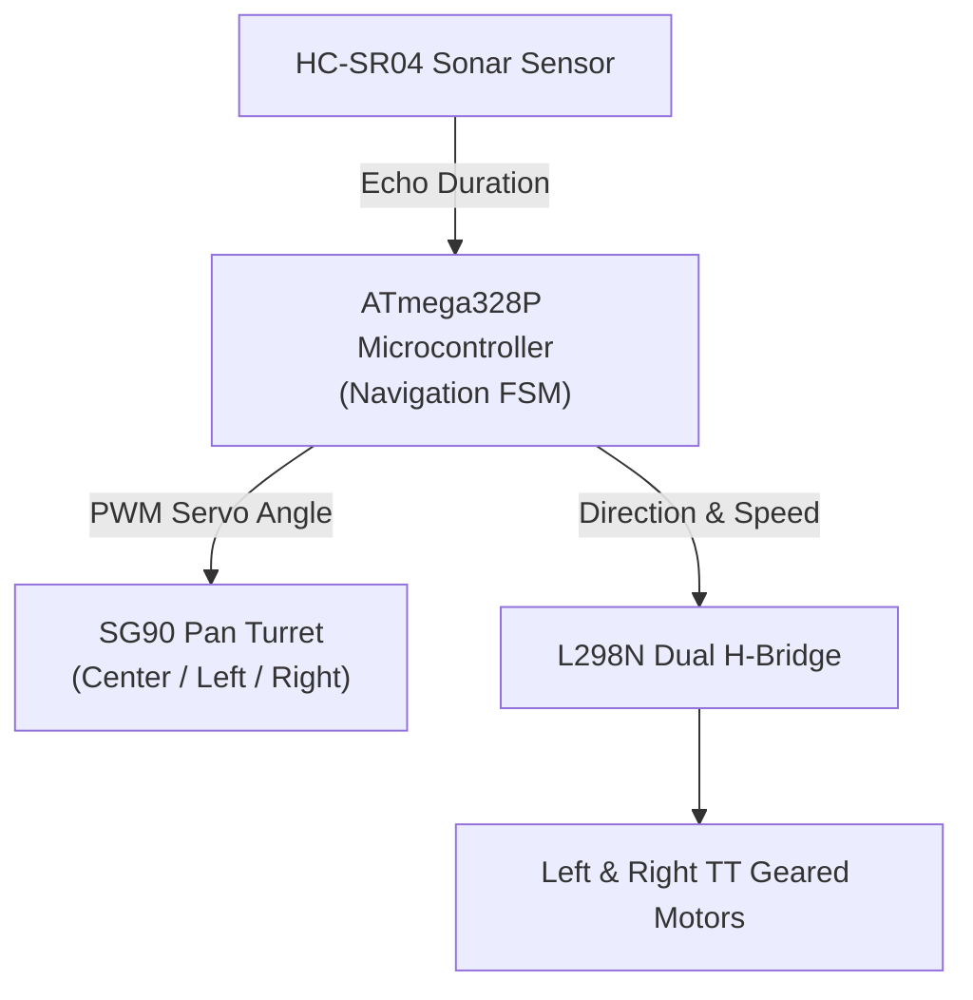

# Autonomous Object Avoiding Robot

[](LICENSE)
[](PROJECT_STATUS.md)
[](hardware/components_list.md)
[](tests/)

An autonomous, 2-wheel differential drive robotic platform capable of real-time obstacle perception, dynamic servo sonar scanning, and collision-free spatial navigation in unstructured indoor environments.

Powered by an ATmega328P microcontroller, an HC-SR04 ultrasonic rangefinder mounted on an SG90 micro-servo pan turret, and an L298N dual H-bridge motor driver, the system executes an event-driven, non-blocking Finite State Machine (FSM) that eliminates CPU deadlocks and guarantees safe maneuvering.

---

## Architecture Overview



---

## Directory Structure

```text
object_avoiding_robot/
├── README.md                          # Project overview and quickstart
├── PROJECT_STATUS.md                  # Lifecycle status and verification matrix
├── LICENSE                            # MIT License
├── .gitignore                         # Build and binary ignores
│
├── source_code/                       # Modular C/C++ firmware
│   ├── include/                       # Header interfaces
│   │   ├── config.h                   # Pinouts, speeds, and distance thresholds
│   │   ├── motor_driver.h             # H-bridge motor driver interface
│   │   ├── ultrasonic_sensor.h        # HC-SR04 sonar interface & EMA filter
│   │   ├── servo_scanner.h            # SG90 pan turret interface
│   │   └── navigation_fsm.h           # Autonomous navigation state machine
│   ├── src/                           # Implementation files
│   │   ├── motor_driver.cpp
│   │   ├── ultrasonic_sensor.cpp
│   │   ├── servo_scanner.cpp
│   │   └── navigation_fsm.cpp
│   └── main/                          # Main Arduino sketch
│       └── object_avoiding_robot.ino  # Non-blocking millis() scheduler
│
├── hardware/                          # Electrical and mechanical documentation
│   ├── components_list.md             # Complete BOM and power budget
│   ├── pin_configuration.md           # MCU pinout mapping table
│   ├── hardware_connections.md        # Physical wiring and assembly guide
│   └── circuit_diagram/
│       └── circuit_schematic.md       # Schematic flow diagram
│
├── architecture/                      # Architectural diagrams and models
│   ├── system_architecture.md         # FSM state machine and subsystems
│   ├── block_diagram.md               # Hardware block interconnects
│   └── data_flow.md                   # Real-time event sequence diagrams
│
├── documentation/                     # Technical and operations manuals
│   ├── technical_documentation.md     # Sonar physics and differential kinematics
│   ├── functional_requirements.md     # Engineering requirements specification
│   ├── installation_guide.md          # Firmware upload and toolchain setup
│   └── troubleshooting.md             # Hardware diagnostic fault matrix
│
├── whitepaper/                        # IEEE formal research publication
│   └── whitepaper.md                  # Full 13-section research whitepaper
│
└── tests/                             # Unit testing suite
    └── unit_tests/
        └── test_navigation_fsm.cpp    # Standalone desktop C++ unit test runner
```

---

## Quickstart

### 1. Compile and Run Desktop Unit Tests
```bash
g++ -Wall -Wextra -Werror -pedantic -std=c++14 -I source_code/include source_code/src/*.cpp tests/unit_tests/test_navigation_fsm.cpp -o test_fsm.exe
./test_fsm.exe
```

### 2. Upload to Arduino UNO
Open `source_code/main/object_avoiding_robot.ino` in Arduino IDE, select **Arduino Uno**, and click **Upload**.

---

## Maintainer
**Aravind Reddy**  
Founder & Lead Engineer, Kernelwise Labs  
GitHub: [@DAravindReddy](https://github.com/DAravindReddy)
