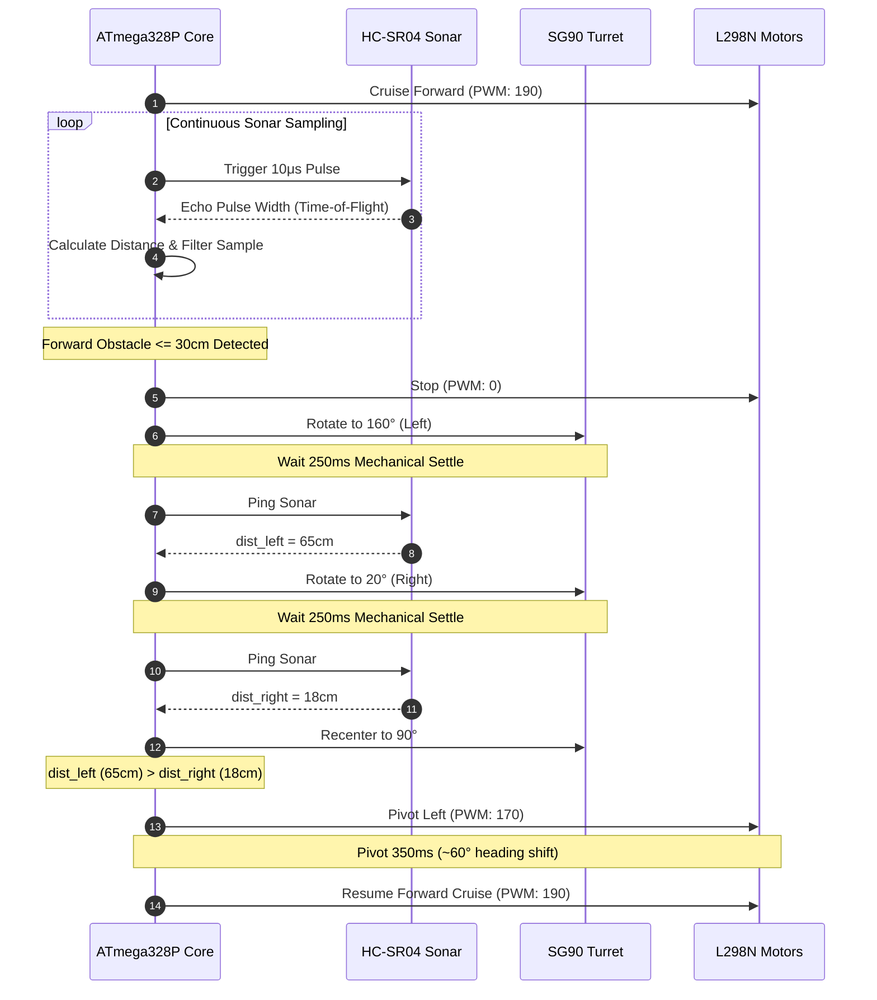

# Object Avoiding Robot - Data Flow & Component Architecture

## 1. Information Data Flow

---

## 2. Component Software Architecture

- **`config.h`**: Hardware pinouts, timer presets, distance thresholds (`DISTANCE_CRITICAL_CM = 15`, `DISTANCE_WARNING_CM = 30`).
- **`motor_driver.h/.cpp`**: Abstracted differential drive primitives (`DRIVE_FORWARD`, `DRIVE_REVERSE`, `DRIVE_PIVOT_LEFT`, `DRIVE_PIVOT_RIGHT`, `DRIVE_STOP`).
- **`ultrasonic_sensor.h/.cpp`**: Sonar pulse trigger and exponential moving average (EMA) noise filter.
- **`servo_scanner.h/.cpp`**: 0° - 180° pan turret servo control.
- **`navigation_fsm.h/.cpp`**: Non-blocking finite state machine evaluating obstacle threats and scheduling transitions.
