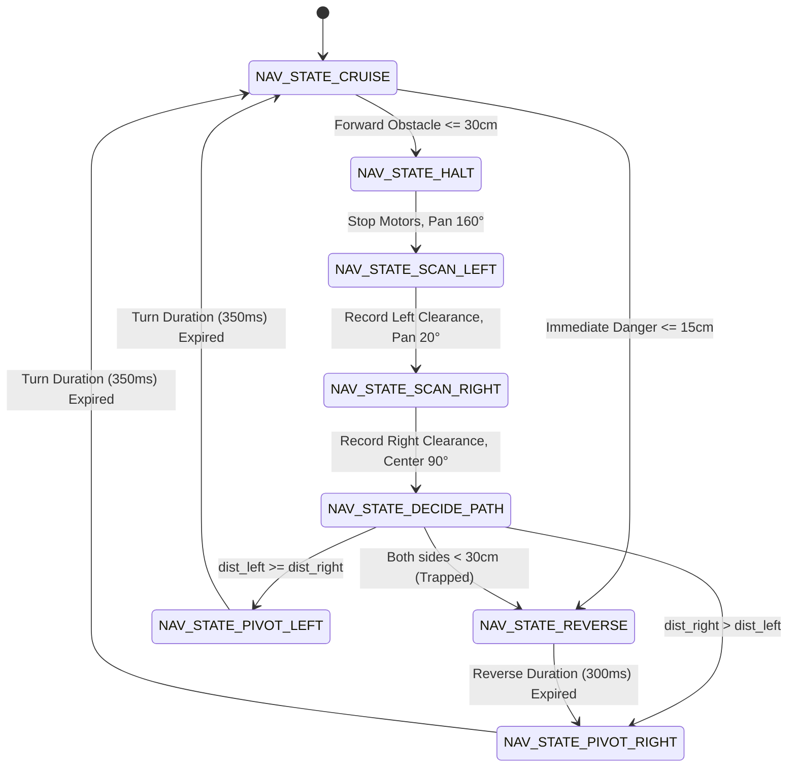

# Object Avoiding Robot - System Architecture

## 1. Architectural Overview

The Autonomous Object Avoiding Robot is an embedded real-time robotics system operating on an event-driven, non-blocking Finite State Machine (FSM). The system continuously assesses forward obstacle clearance, initiates pan-tilt sonar sweeps upon approaching spatial obstacles, evaluates alternative trajectory paths, and commands differential steering actuators to maneuver around collisions.

```mermaid
flowchart TD
    subgraph Sensing ["Perception & Sensing Subsystem"]
        HC["HC-SR04 Ultrasonic Sonar"]
        ServoTurret["SG90 Panning Turret\n(Center 90°, Left 160°, Right 20°)"]
    end

    subgraph Controller ["Decision & Scheduling Core (Arduino UNO)"]
        EchoFilter["Echo Time-of-Flight Filter\n(Outlier rejection & EMA)"]
        FSM["Navigation Finite State Machine\n(CRUISE, HALT, SCAN, DECIDE, PIVOT, REVERSE)"]
        Scheduler["Non-Blocking Timer Scheduler\n(millis() tick generator)"]
    end

    subgraph Actuation ["Locomotion & Actuation Subsystem"]
        HBridge["L298N Dual H-Bridge Driver\n(Directional Inverters & PWM Gates)"]
        LeftMotor["Left TT Geared DC Motor"]
        RightMotor["Right TT Geared DC Motor"]
    end

    HC -->|Echo Pulse Width| EchoFilter
    EchoFilter -->|Filtered Clearance (cm)| FSM
    Scheduler -->|Tick 20ms| FSM

    FSM -->|Target Pan Angle| ServoTurret
    FSM -->|Direction & PWM Speed| HBridge
    HBridge -->|OUT1/OUT2| LeftMotor
    HBridge -->|OUT3/OUT4| RightMotor
```

---

## 2. Finite State Machine Dynamics


