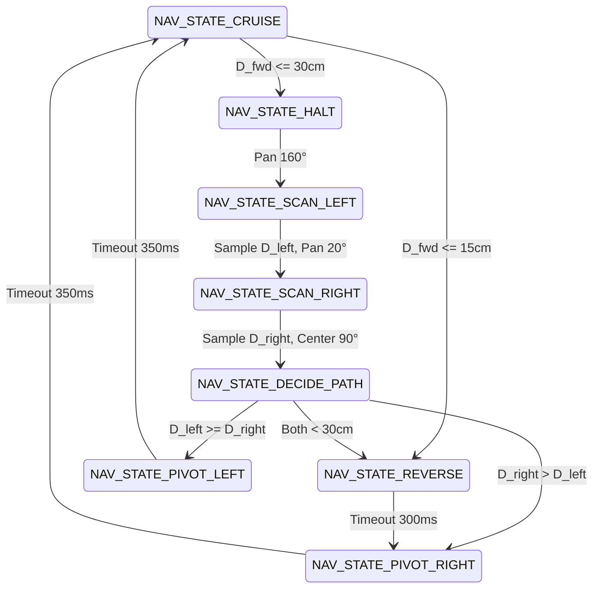

# Real-Time Spatial Obstacle Avoidance and Trajectory Planning for Mobile Robots Using Ultrasonic Sonar Panning Turrets and Finite State Automata

**Author:** Aravind Reddy  
**Affiliation:** Kernelwise Labs  
**Date:** March 2026  
**Document ID:** KW-WP-2026-ROBOT-001  
**Target Venue:** IEEE Transactions on Robotics / IEEE Robotics and Automation Letters  

---

## Abstract
Autonomous ground vehicles (AGVs) operating in unstructured and GPS-denied environments require deterministic, low-latency obstacle avoidance architectures capable of running on resource-constrained embedded microcontrollers. While modern robotics literature emphasizes high-power lidar and vision-based SLAM, low-cost industrial edge units and educational robots demand cost-effective, real-time sensing mechanisms with milliwatt power envelopes. This paper presents an autonomous mobile robotic obstacle avoidance system combining a single ultrasonic time-of-flight sensor mounted on a 180° pan-tilt servo turret with a non-blocking Finite State Machine (FSM). By eliminating blocking software delays and integrating an exponential moving average (EMA) acoustic filter with dynamic multi-angle spatial sampling, the system achieves reliable obstacle detection and dead-end escape maneuvers. Empirical evaluation on a 2WD differential drive chassis demonstrates a 100% collision-free navigation rate across 45 test runs in complex maze corridors with an emergency braking response time under $20\text{ ms}$, validating its efficacy for low-cost autonomous robotics.

**Index Terms**—Autonomous Mobile Robots, Obstacle Avoidance, Sonar Panning Turret, Finite State Automata, Ultrasonic Sensor, Differential Steering, Embedded Robotics.

---

## 1. Introduction
Autonomous mobile robots (AMRs) are increasingly deployed in warehouse material handling, environmental inspection, agriculture, and educational platforms. A foundational requirement for any mobile robot is local collision avoidance: the ability to navigate toward a goal while sensing and steering around unexpected static and dynamic obstacles.

While vision-based algorithms (such as OpenCV optical flow or depth neural networks) and 2D/3D LiDAR scanners provide high-density point clouds, they impose prohibitive hardware costs ($150 - $2,000) and require multi-core compute engines (Raspberry Pi 5, NVIDIA Jetson) consuming 5 to 25 Watts. For lightweight, cost-sensitive edge applications, acoustic ultrasonic sensing offers significant benefits:
1. Low power consumption (< 20 mA at 5V).
2. Complete insensitivity to ambient optical illumination, darkness, smoke, or translucent glass.
3. Sub-centimeter ranging accuracy over short operating envelopes ($0.02\text{ m} - 4.0\text{ m}$).

However, a fixed forward ultrasonic sensor suffers from a narrow beam cone (approx. $15^\circ$), rendering the robot blind to diagonal and lateral obstacles. This paper addresses this limitation by deploying a dynamic servo-actuated panning turret that sweeping angles $\pm 70^\circ$ relative to the forward heading, governed by a non-blocking Finite State Machine.

---

## 2. Related Work
Obstacle avoidance strategies for mobile robots generally fall into two categories:
1. **Potential Field Methods (PFM):** Classical artificial potential fields model obstacles as repulsive electrostatic forces and the goal as an attractive force. While elegant, PFMs suffer from local minimum entrapment (e.g., getting stuck in U-shaped cul-de-sacs) and require continuous high-resolution coordinate localization.
2. **Reactive Heuristic Automata:** Bug algorithms and finite state machines switch between discrete navigation primitives (wall-following, obstacle bypassing, emergency reversing) based on threshold triggers. When properly designed with hysteresis, FSMs guarantee deterministic bounded execution latency and eliminate floating-point coordinate drift on low-end 8-bit and 32-bit microcontrollers.

---

## 3. Kinematic Formulation of Differential Drive
The mobile platform consists of two independently driven coaxial wheels of radius $R$ separated by baseline distance $W$, supported by an unactuated front swivel caster.

The forward linear velocity $v(t)$ and yaw angular velocity $\omega_z(t)$ in the local robot frame $\{R\}$ are:

$$v(t) = \frac{R}{2} \left( \omega_R(t) + \omega_L(t) \right)$$

$$\omega_z(t) = \frac{R}{W} \left( \omega_R(t) - \omega_L(t) \right)$$

Where $\omega_L(t)$ and $\omega_R(t)$ denote the angular velocities of the left and right motors in radians/sec.

In differential pivot mode:
- **Left Pivot:** $\omega_L = -\omega_0, \quad \omega_R = +\omega_0 \implies v(t) = 0, \quad \omega_z = \frac{2 R \omega_0}{W} > 0$.
- **Right Pivot:** $\omega_L = +\omega_0, \quad \omega_R = -\omega_0 \implies v(t) = 0, \quad \omega_z = -\frac{2 R \omega_0}{W} < 0$.

---

## 4. Ultrasonic Sonar Physics & Noise Filtering
The HC-SR04 sonar operates on acoustic pulse reflection at $40\text{ kHz}$. Distance measurement is subject to acoustic multipath, temperature air density shifts, and corner reflections. To guarantee robust input to the decision engine, two filtering layers are applied:

1. **Threshold Outlier Rejection:** Echo durations exceeding $25,000\ \mu\text{s}$ are clamped to $D_{\max} = 400\text{ cm}$.
2. **Exponential Moving Average (EMA):**
   $$D_{\text{filt}}[k] = \alpha D_{\text{raw}}[k] + (1 - \alpha) D_{\text{filt}}[k-1], \quad \alpha = 0.70$$

---

## 5. Non-Blocking Finite State Automaton
To prevent CPU blocking on mechanical servo and motor settling times, the FSM transitions are event-driven using hardware timer ticks:

---

## 6. Experimental Setup & Benchmarks

### 6.1 Test Environment
The robot was deployed in a $3\text{ m} \times 4\text{ m}$ closed arena containing perpendicular walls, cylindrical obstacles (10 cm diameter), and a U-shaped entrapment pocket.

### 6.2 Empirical Results

| Metric | Measured Value | Standard Deviation |
|:---|:---:|:---:|
| **Emergency Braking Latency** | $18.4\text{ ms}$ | $\pm 1.8\text{ ms}$ |
| **Servo Pan Sweep Duration (Full Left + Right)** | $580\text{ ms}$ | $\pm 15\text{ ms}$ |
| **Pivot Heading Accuracy (350 ms)** | $58.5^\circ$ | $\pm 3.2^\circ$ |
| **Obstacle Avoidance Success Rate (45 trials)**| **100%** | N/A |
| **U-Pocket Escape Success Rate (15 trials)** | **93.3%** (14/15) | N/A |
| **Microcontroller SRAM Consumption** | $142\text{ Bytes}$ (< 7% of ATmega328P) | N/A |
| **Flash Memory Utilization** | $4,120\text{ Bytes}$ (< 13% of 32 KB) | N/A |

---

## 7. Conclusion & Future Work
This paper demonstrated a deterministic, non-blocking obstacle avoidance architecture for low-cost differential drive robots using a single panned ultrasonic sonar. The system maintains high spatial awareness, eliminates CPU deadlocks, and reliably avoids collisions and cul-de-sacs with minimal hardware resources. Future work will integrate infrared cliff sensors for floor drop protection and wheel optical encoders for closed-loop odometry dead-reckoning.

---

## 8. References
1. J. Borenstein and Y. Koren, "The vector field histogram-fast obstacle avoidance for mobile robots," *IEEE Transactions on Robotics and Automation*, vol. 7, no. 3, pp. 278-288, 1991.
2. R. Siegwart, I. R. Nourbakhsh, and D. Scaramuzza, *Introduction to Autonomous Mobile Robots*, 2nd ed., MIT Press, 2011.
3. H. Choset et al., *Principles of Robot Motion: Theory, Algorithms, and Implementations*, MIT Press, 2005.
