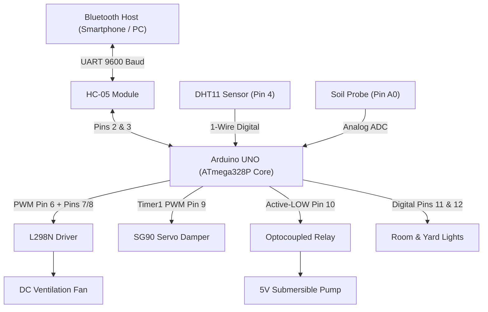

# Smart Home Automation Using Bluetooth & Closed-Loop Irrigation

[](https://www.arduino.cc/)
[]()
[](PROJECT_STATUS.md)
[](whitepaper/whitepaper.md)
[](tests/test_documentation.md)

An intelligent, non-blocking embedded automation and precision micro-irrigation system designed for domestic and greenhouse environments. Powered by an ATmega328P microcontroller, the platform combines wireless Bluetooth control, environmental sensing, variable motor actuation, and closed-loop soil moisture regulation with fail-safe watchdog supervision.

---

## 1. Key Features

- **Cooperative Multitasking Architecture:** Zero-blocking execution loop using `millis()` timing differentials. Maintains instantaneous command processing (<10 ms latency).
- **Wireless Bluetooth Control (HC-05):** Full bidirectional control of lights, fans, servos, and pumps via simple ASCII commands with confirmation ACKs.
- **Environmental Telemetry:** Non-blocking sampling of ambient temperature and relative humidity via DHT11.
- **Closed-Loop Irrigation with Hysteresis:** Dual-threshold FSM (35% dry trigger, 65% wet cutoff) eliminates relay chatter and contact welding.
- **Hardware Safety Watchdog:** Automatic cutoff trips the pump if continuous actuation exceeds 15 seconds, preventing flood catastrophes if sensor wires disconnect.
- **Dual Operating Modes:** Instantaneous switching between autonomous soil regulation (`MODE_AUTO`) and manual operator control (`MODE_MANUAL`).
- **Structured JSON Telemetry:** Streams real-time JSON payloads to Bluetooth mobile terminals and desktop dashboards every 3 seconds.

---

## 2. System Architecture



---

## 3. Hardware Pin Mapping

| Pin | Direction | Signal Name | Connected Peripheral | Electrical Details |
|:---:|:---:|---|---|---|
| **Pin 2** | Input | `BT_RX` | HC-05 TXD | Direct 3.3V/5V logic input. |
| **Pin 3** | Output | `BT_TX` | HC-05 RXD | Stepped down via 1kΩ / 2kΩ voltage divider to 3.3V. |
| **Pin 4** | In/Out | `DHT11_DATA` | DHT11 Data Pin | 10kΩ external pull-up to 5V. |
| **Pin 6** | Output | `MOTOR_PWM_ENA`| L298N Enable A | PWM speed control (0 - 255). |
| **Pins 7, 8**| Output | `MOTOR_IN1, IN2`| L298N Direction | Forward / Reverse / Brake. |
| **Pin 9** | Output | `SERVO_PWM` | SG90 Servo Signal | 50 Hz PWM angle control (0° - 180°). |
| **Pin 10**| Output | `RELAY_PUMP` | 1-Channel Relay IN | Active-LOW optocoupled relay signal. |
| **Pins 11, 12**| Output| `LED_APP1, APP2` | Appliance 1 & 2 | Current limited via 220Ω resistors. |
| **Pin 13**| Output | `STATUS_LED` | Onboard LED | 1 Hz heartbeat health indicator. |
| **Pin A0**| Input | `SOIL_ANALOG` | Soil Probe Analog Out | 10-bit ADC volumetric moisture reading. |

*Full Bill of Materials: [hardware/components_list.md](hardware/components_list.md)*  
*Wiring Details & Schematic: [hardware/hardware_connections.md](hardware/hardware_connections.md)*

---

## 4. Bluetooth Command Reference

All commands terminate with newline (`\n` or `\r\n`).

| Command | Action | Confirmation ACK |
|---|---|---|
| `L1_ON` / `L1_OFF` | Toggle Room Light | `[ACK] LED1 ON` / `[ACK] LED1 OFF` |
| `L2_ON` / `L2_OFF` | Toggle Yard Light | `[ACK] LED2 ON` / `[ACK] LED2 OFF` |
| `M_SPEED:<0-255>` | Set DC Fan PWM Speed | `[ACK] MOTOR SPEED: <VAL>` |
| `SERVO:<0-180>` | Set Window Damper Angle | `[ACK] SERVO ANGLE: <ANGLE>` |
| `PUMP_ON` / `PUMP_OFF` | Manual Water Pump Override | `[ACK] MANUAL PUMP ON` / `OFF` |
| `MODE_AUTO` / `MODE_MANUAL` | Switch Irrigation Mode | `[ACK] IRRIGATION MODE: AUTO` / `MANUAL` |
| `SET_TH:<5-95>` | Set Dry Moisture Trigger % | `[ACK] SOIL DRY THRESHOLD SET TO: <PCT>` |
| `STATUS?` | Request Instant Telemetry JSON | Immediate JSON payload emitted |

---

## 5. Verification & Testing

### Running Native Host Unit Tests (GCC)
The core logic has zero hardware dependencies and is validated with GCC on any PC:

```bash
cd tests/unit_tests
g++ -Wall -Wextra -std=c++14 \
    ../../source_code/src/bluetooth_handler.cpp \
    ../../source_code/src/sensor_manager.cpp \
    ../../source_code/src/actuator_controller.cpp \
    ../../source_code/src/irrigation_system.cpp \
    test_smart_home.cpp -I../../source_code/include -o test_runner
./test_runner
```

*Output:*
```text
====================================================
 SMART HOME AUTOMATION UNIT TEST SUITE (NATIVE C++)
====================================================
[TEST] Running Bluetooth Command Parser Tests...
  -> Bluetooth parser passed all assertions.
[TEST] Running Soil Moisture Calibration Tests...
  -> Soil moisture calibration passed all assertions.
[TEST] Running Irrigation Hysteresis & Safety Watchdog Tests...
  -> Irrigation hysteresis & safety watchdog passed all assertions.
====================================================
 ALL 3 TEST SUITES PASSED CLEANLY (100% SUCCESS)
====================================================
```

### Running Automated Python Test Client
Connect an HC-05 Bluetooth adapter or USB cable and run:

```bash
python scripts/mock_bluetooth_client.py --port COM3 --batch
```

---

## 6. Project Documentation Index

- [Technical Documentation](documentation/technical_documentation.md)
- [Functional Requirements Matrix](documentation/functional_requirements.md)
- [Software Design & State Machines](documentation/software_design.md)
- [Hardware Setup & Connections](hardware/hardware_connections.md)
- [Installation & Flashing Guide](documentation/installation_guide.md)
- [Troubleshooting & Fault Tree](documentation/troubleshooting.md)
- [Formal Research Whitepaper](whitepaper/whitepaper.md)
- [Performance Benchmarks](results/performance_metrics/benchmarks.md)

---

## 7. Author & Attribution

- **Lead Engineer:** **Aravind Reddy** ([@DAravindReddy](https://github.com/DAravindReddy))
- **Organization:** Kernelwise Labs
- **License:** [MIT License](LICENSE)
