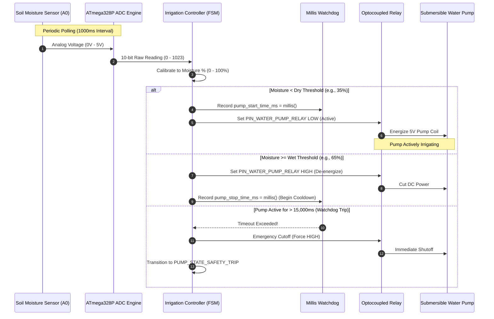
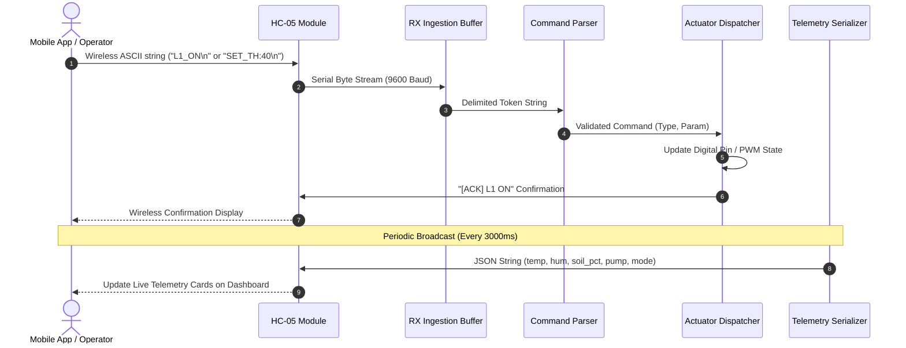

# Data Flow & Sequence Architecture

**Project:** Smart Home Automation with Bluetooth & Closed-Loop Irrigation  

---

## 1. Closed-Loop Irrigation Data Flow

---

## 2. Bluetooth Command & Telemetry Sequence

