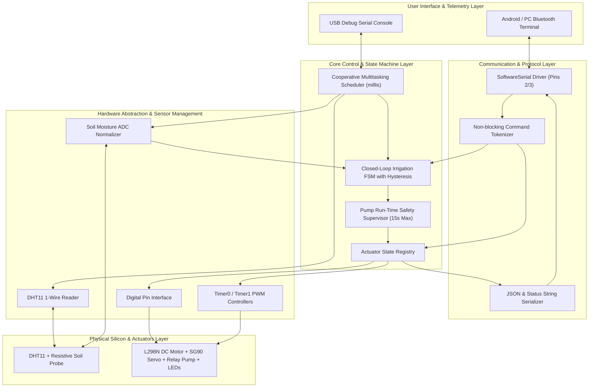

# System Architecture Specification

**Project:** Smart Home Automation with Bluetooth & Closed-Loop Irrigation  
**Domain:** Embedded Automation & Mechatronic Control  
**Architect:** Aravind Reddy ([@DAravindReddy](https://github.com/DAravindReddy))  

---

## 1. Architectural Overview

The Smart Home Automation and Closed-Loop Irrigation system is structured as a hierarchical embedded architecture decoupled into distinct physical, driver, logic, and presentation layers:

---

## 2. Key Architectural Design Decisions

1. **Zero-Blocking Execution Loop:**
   To guarantee rapid command responsiveness (<50ms latency) over Bluetooth, traditional `delay()` statements are eliminated. The system uses timestamp differential scheduling (`millis() - last_time >= interval`), maintaining high loop throughput.
2. **Dual-Mode Irrigation with Safety Interlock:**
   The irrigation sub-system operates under two mutually exclusive modes:
   - `AUTO Mode`: Autonomous closed-loop control governed by soil moisture hysteresis.
   - `MANUAL Mode`: Remote operator override.
   In both modes, a hardware safety watchdog trips the pump if continuous actuation exceeds 15 seconds, preventing catastrophic flooding in the event of dry-well conditions or probe dislocation.
3. **Hardware Independence:**
   Core control algorithms (command parsing, moisture percentage mapping, and hysteresis state logic) are completely separated from Arduino hardware headers, allowing native C++ unit testing on development workstations.
