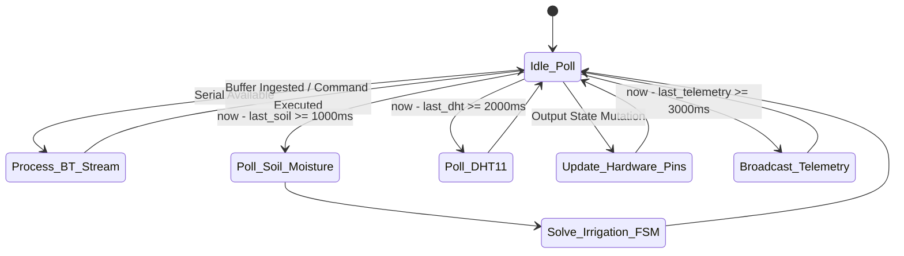

# Software Design Specification

**Project:** Smart Home Automation with Bluetooth & Closed-Loop Irrigation  

---

## 1. Concurrency Model: Cooperative Multitasking

The ATmega328P microcontroller operates on a single core at 16 MHz without a preemptive real-time operating system (RTOS). To satisfy hard timing deadlines across communication and sensor sampling without race conditions, execution is structured around cooperative time-sliced polling:



---

## 2. Irrigation Finite State Machine (FSM)

```mermaid
stateDiagram-v2
    [*] --> IDLE

    state IDLE {
        description: "Pump OFF. Monitoring soil moisture."
    }
    state WATERING {
        description: "Pump ON. Delivering water. Tracking elapsed time."
    }
    state COOLDOWN {
        description: "Pump OFF. Allowing water percolation (5000ms)."
    }
    state SAFETY_TRIP {
        description: "EMERGENCY CUTOFF. Pump locked OFF."
    }

    IDLE --> WATERING : Soil Moisture < Dry_Threshold (35%)
    WATERING --> COOLDOWN : Soil Moisture >= Wet_Threshold (65%)
    WATERING --> SAFETY_TRIP : Elapsed Run Time >= 15,000ms
    COOLDOWN --> IDLE : Elapsed Cooldown >= 5,000ms
    SAFETY_TRIP --> IDLE : Operator Manual Reset (PUMP_OFF)
```
