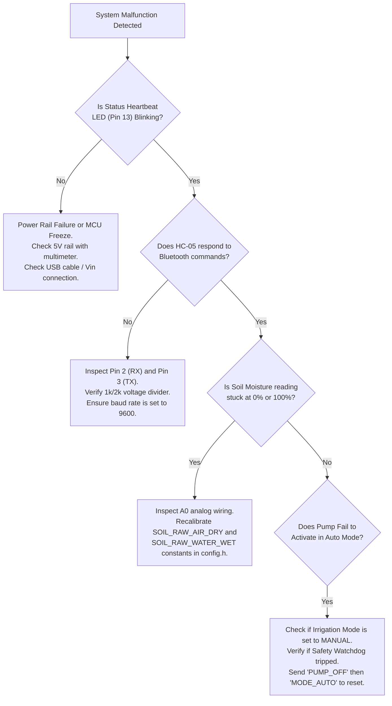

# Hardware and Software Troubleshooting Guide

**Project:** Smart Home Automation with Bluetooth & Closed-Loop Irrigation  

---

## 1. Diagnostic Fault Tree

---

## 2. Common Symptoms and Root Cause Analysis

| Symptom | Probable Root Cause | Corrective Action |
|---|---|---|
| **HC-05 paired but won't send/receive text** | Inverted TX/RX lines or incorrect baud rate. | Swap Pin 2 and Pin 3 connections; ensure terminal app uses 9600 baud and appends `\r\n`. |
| **Arduino resets when DC Motor starts** | High inrush current drawing down 5V rail. | Power L298N motor driver from external 12V supply; do not power motor from Arduino 5V header. |
| **Water pump turns on briefly and stays off** | Safety Watchdog tripped due to dry sensor or prolonged run time. | Check water reservoir level and probe placement. Send `PUMP_OFF` to clear error state. |
| **DHT11 returns invalid readings** | Missing pull-up resistor or read frequency > 0.5 Hz. | Install a 10kΩ pull-up resistor between 5V and DATA. Ensure read interval $\ge 2000$ms. |
