# Circuit Schematic & Wiring Interconnects

**Project:** Smart Home Automation with Bluetooth & Closed-Loop Irrigation  
**Revision:** Rev 1.1  

---

## 1. High-Level System Wiring Topology

```mermaid
graph TD
    subgraph Controller_Board ["Arduino UNO Rev3"]
        P2["Pin 2 (BT RX)"]
        P3["Pin 3 (BT TX)"]
        P4["Pin 4 (DHT11 Data)"]
        P6["Pin 6 (Motor PWM)"]
        P7["Pin 7 (Motor IN1)"]
        P8["Pin 8 (Motor IN2)"]
        P9["Pin 9 (Servo PWM)"]
        P10["Pin 10 (Pump Relay)"]
        P11["Pin 11 (Appliance 1)"]
        P12["Pin 12 (Appliance 2)"]
        P13["Pin 13 (Heartbeat LED)"]
        PA0["Pin A0 (Soil ADC)"]
        GND["GND Rail"]
        VCC5["5V Rail"]
    end

    subgraph Communication ["Bluetooth Transceiver"]
        HC05_TX["HC-05 TXD"] --> P2
        P3 --> Divider["1kΩ / 2kΩ Voltage Divider"] --> HC05_RX["HC-05 RXD"]
        VCC5 --> HC05_VCC["HC-05 VCC"]
        GND --> HC05_GND["HC-05 GND"]
    end

    subgraph Environmental_Sensing ["Environmental & Soil"]
        VCC5 --> DHT_VCC["DHT11 VCC"]
        GND --> DHT_GND["DHT11 GND"]
        DHT_DATA["DHT11 DATA"] --> P4
        VCC5 --- Resistor_Pullup["10kΩ Pullup"] --- DHT_DATA

        VCC5 --> SOIL_VCC["Soil Sensor VCC"]
        GND --> SOIL_GND["Soil Sensor GND"]
        SOIL_SIG["Soil Sensor AOUT"] --> PA0
    end

    subgraph Power_Actuators ["High-Current Actuators"]
        P6 --> L298N_ENA["L298N ENA"]
        P7 --> L298N_IN1["L298N IN1"]
        P8 --> L298N_IN2["L298N IN2"]
        L298N_OUT["L298N OUT1/OUT2"] --> DCMotor["DC Ventilation Fan"]

        P9 --> Servo_SIG["SG90 Signal"]
        
        P10 --> Relay_IN["Relay Module IN"]
        Relay_COM["Relay COM / NO"] --> WaterPump["Submersible Water Pump"]

        P11 --> R1["220Ω"] --> LED1["Room Light LED"]
        P12 --> R2["220Ω"] --> LED2["Yard Light LED"]
    end

    subgraph External_Power ["External 12V / 5V DC Supply"]
        Ext12V["12V Power Bus"] --> L298N_Vin["L298N Motor Vin"]
        ExtGND["Power GND"] --> GND
        Ext5V["Regulated 5V Bus"] --> Relay_VCC["Relay VCC"]
        Ext5V --> Servo_VCC["SG90 VCC"]
        Ext12V --> Relay_COM
    end
```



---

## 2. Safety Interlocks & Relay Snubber Circuitry

Inductive kickback from switching the DC motor and submersible water pump can cause reset loops on the ATmega328P. 

1. **Optocoupler Isolation:** The 1-channel relay module utilizes a PC817 optocoupler, isolating the microcontroller's digital switching line from the relay coil current.
2. **Flyback Protection:** A 1N4007 freewheeling diode is mounted anti-parallel across the DC motor and water pump terminals to clamp inductive flyback spikes when de-energized:

```text
Relay NO Terminal (+V) ----+----------------------+
                           |                      |
                         [Pump]               [|< 1N4007 Diode]
                           |                      |
Relay COM / GND       ----+----------------------+
```
