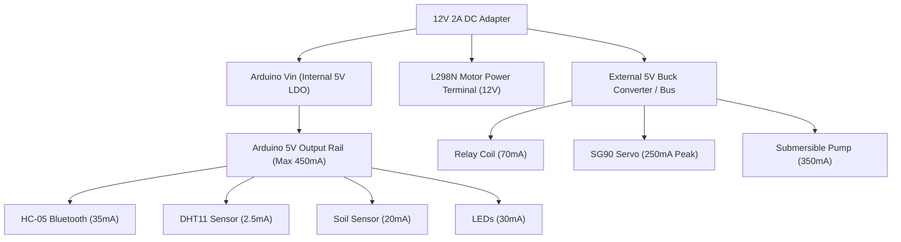

# Bill of Materials (BOM) & Components List

**Project:** Smart Home Automation with Bluetooth & Closed-Loop Irrigation  
**Hardware Platform:** Arduino UNO (Microchip ATmega328P)  
**Maintained by:** Aravind Reddy ([@DAravindReddy](https://github.com/DAravindReddy))  

---

## 1. Primary Components & Electrical Specifications

| Item | Component Description | Model / Part No. | Operating Voltage | Peak Current | Interfacing Bus | Function / Role |
|:---:|---|---|:---:|:---:|:---:|---|
| 1 | Microcontroller Board | Arduino UNO Rev3 (ATmega328P) | 5V DC (USB / 7-12V Vin) | 50 mA | GPIO / ADC / UART | Central supervisor, state machine, sensor polling, actuator orchestration. |
| 2 | Wireless Communication | HC-05 Bluetooth Module | 3.6V - 6.0V (VCC), 3.3V Logic | 35 mA | UART (SoftwareSerial) | Bidirectional serial bridge to mobile/tablet terminal application. |
| 3 | Environmental Sensor | DHT11 Temperature & Humidity | 3.3V - 5.5V DC | 2.5 mA | 1-Wire Proprietary | Ambient room temperature (0-50°C) and relative humidity (20-90% RH). |
| 4 | Soil Moisture Sensor | Resistive Soil Moisture Probe | 3.3V - 5.0V DC | 20 mA | Analog Output (ADC A0) | Volumetric water content detection in agricultural/garden soil. |
| 5 | DC Motor Driver | L298N Dual H-Bridge | 5V Logic, 7-35V Motor Vin | 2.0A per channel | PWM + Dual Direction GPIO | Variable speed DC fan / ventilation motor actuation. |
| 6 | DC Motor | 6V-12V Brushed DC Motor | 6V - 12V DC | 300 - 800 mA | L298N Output Terminals | Simulated ventilation fan or motorized curtains. |
| 7 | Servo Actuator | SG90 9g Micro Servo | 4.8V - 6.0V DC | 250 mA (Stall) | Timer1 PWM (50 Hz) | Window damper / automated door vent positioning (0° - 180°). |
| 8 | Irrigation Pump | 5V Submersible DC Water Pump | 3.5V - 9.0V DC | 200 - 350 mA | Relay Switched | Soil irrigation delivery to root zone. |
| 9 | Relay Module | 1-Channel 5V Optocoupler Relay | 5V DC | 70 mA (Coil energized) | GPIO Active-LOW | Galvanic isolation between microcontroller and inductive pump. |
| 10 | Appliance Indicators | 5mm Diffused LEDs (Red, Green) | 2.0V - 3.2V DC | 15 - 20 mA | Current-limited GPIO | Visual status indication for Room Light (L1) and Yard Light (L2). |
| 11 | Passive Passives | 220Ω, 1kΩ, 2kΩ, 10kΩ Resistors | - | - | Through-hole | Current limiters for LEDs, DHT11 pull-up, HC-05 RX level divider. |
| 12 | Power Supply | 12V 2A DC Wall Adapter | 100-240V AC In | 2000 mA | Barrel Jack | Primary input to Arduino Vin and L298N Motor supply rail. |

---

## 2. Electrical Isolation & Power Budgeting

> [!IMPORTANT]
> **Power Isolation Notice:** While the low-power sensors (DHT11, Soil Probe) and Bluetooth module are safely powered from the Arduino 5V onboard linear regulator, high-transient inductive loads (SG90 servo motor and DC water pump) must share an external 5V regulator or power tap with a **common ground (GND)** connection. This protects the ATmega328P from brownouts and inductive voltage spikes.
