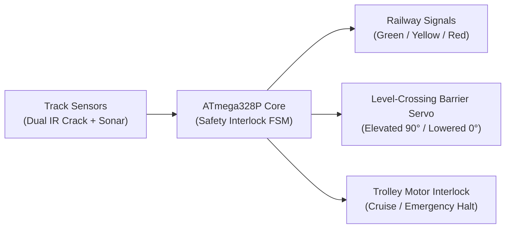

# Smart Railway Track System

[](LICENSE)
[](PROJECT_STATUS.md)
[](hardware/components_list.md)
[](tests/)

An autonomous embedded railway track safety, crack detection, obstacle avoidance, and multi-aspect signaling interlock system designed to prevent train derailments and grade-crossing collisions.

Equipped with dual optical infrared reflectance sensors targeting each rail crown, an HC-SR04 ultrasonic rangefinder for track obstruction perception, an automated SG90 crossing gate servo, and a 3-aspect color light signal mast (Green/Yellow/Red), the system executes a prioritized fail-safe Finite State Machine (FSM) that guarantees immediate emergency halting upon structural rail fractures or track blockage.

---

## Architecture Overview



---

## Directory Structure

```text
smart_railway_system/
├── README.md                          # Project overview and quickstart
├── PROJECT_STATUS.md                  # Lifecycle status and verification matrix
├── LICENSE                            # MIT License
├── .gitignore                         # Build and binary ignores
│
├── source_code/                       # Modular C/C++ firmware
│   ├── include/                       # Header interfaces
│   │   ├── config.h                   # Pin definitions, thresholds, debounce timings
│   │   ├── crack_detector.h           # Dual IR rail sensor interface & debouncer
│   │   ├── obstacle_sonar.h           # Ultrasonic rangefinder interface
│   │   ├── signal_gate_controller.h   # Multi-aspect signal and servo barrier controller
│   │   └── railway_fsm.h              # Prioritized safety finite state machine
│   ├── src/                           # Implementation files
│   │   ├── crack_detector.cpp
│   │   ├── obstacle_sonar.cpp
│   │   ├── signal_gate_controller.cpp
│   │   └── railway_fsm.cpp
│   └── main/                          # Main Arduino sketch
│       └── smart_railway_system.ino   # Non-blocking millis() scheduler
│
├── hardware/                          # Electrical and mechanical documentation
│   ├── components_list.md             # Complete BOM and power budget
│   ├── pin_configuration.md           # MCU pinout mapping table
│   ├── hardware_connections.md        # Physical wiring and assembly guide
│   └── circuit_diagram/
│       └── circuit_schematic.md       # Schematic flow diagram
│
├── architecture/                      # Architectural diagrams and models
│   ├── system_architecture.md         # FSM state machine and subsystems
│   └── block_diagram.md               # Hardware block interconnects
│
├── documentation/                     # Technical and operations manuals
│   ├── technical_documentation.md     # Optical crack physics and signaling
│   ├── functional_requirements.md     # Engineering requirements specification
│   └── installation_guide.md          # Firmware upload and troubleshooting
│
├── whitepaper/                        # IEEE formal research publication
│   └── whitepaper.md                  # Full 13-section research whitepaper
│
└── tests/                             # Unit testing suite
    └── unit_tests/
        └── test_railway_fsm.cpp       # Standalone desktop C++ unit test runner
```

---

## Quickstart

### 1. Compile and Run Desktop Unit Tests
```bash
g++ -Wall -Wextra -Werror -pedantic -std=c++14 -I source_code/include source_code/src/*.cpp tests/unit_tests/test_railway_fsm.cpp -o test_rail.exe
./test_rail.exe
```

### 2. Upload to Arduino UNO
Open `source_code/main/smart_railway_system.ino` in Arduino IDE, select **Arduino Uno**, and click **Upload**.

---

## Maintainer
**Aravind Reddy**  
Founder & Lead Engineer, Kernelwise Labs  
GitHub: [@DAravindReddy](https://github.com/DAravindReddy)
