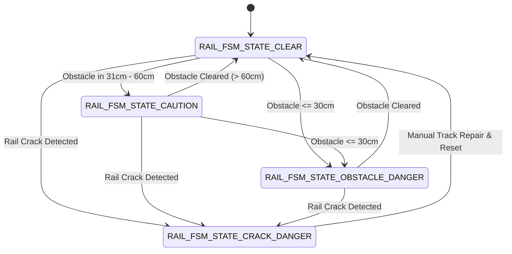

# Smart Railway Track System - System Architecture

## 1. Architectural Overview

The Smart Railway Track System is an autonomous safety, inspection, and signaling architecture that provides continuous structural track integrity verification, contactless obstacle collision prevention, and fail-safe multi-aspect signal control.

```mermaid
flowchart TD
    subgraph TrackSensors ["Track Perception & Integrity Subsystem"]
        IR_L["Left Rail IR Reflective Sensor\n(Optical Fissure Detector)"]
        IR_R["Right Rail IR Reflective Sensor\n(Optical Fissure Detector)"]
        Sonar["HC-SR04 Ultrasonic Sonar\n(Obstacle Time-of-Flight)"]
        Debouncer["Crack Signal Debouncer\n(40ms Vibration Noise Filter)"]
    end

    subgraph DecisionCore ["Safety Decision & FSM Core (Arduino UNO)"]
        FSM["Railway Safety State Machine\n(Priority 1: Structural Crack\nPriority 2: Obstacle Danger\nPriority 3: Obstacle Caution\nPriority 4: Track Clear)"]
        TrolleyGovernor["Autonomous Trolley Speed Governor\n(Cruise / Half / Emergency Halt)"]
    end

    subgraph SafetyOutputs ["Trackside Signaling & Protection Actuators"]
        SignalHead["3-Aspect Signal Mast\n(Green Proceed / Yellow Caution / Red Danger)"]
        GateServo["Level-Crossing Barrier Servo\n(Elevated 90° / Lowered 0°)"]
        Alarm["Piezo Alert Siren & Strobe"]
        TrolleyMotor["Inspection Trolley Motor\n(L298N Drive)"]
    end

    IR_L --> Debouncer
    IR_R --> Debouncer
    Debouncer -->|Rail Status| FSM
    Sonar -->|Clearance Distance (cm)| FSM

    FSM -->|Aspect Command| SignalHead
    FSM -->|Gate Angle Command| GateServo
    FSM -->|Alert Gate| Alarm
    FSM --> TrolleyGovernor
    TrolleyGovernor --> TrolleyMotor
```

---

## 2. Priority-Driven Safety State Machine


