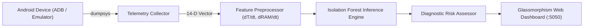

# Android Device Health Prediction AI — Autonomous Failure Diagnostics

[](https://www.python.org/)
[](https://scikit-learn.org/)
[](PROJECT_STATUS.md)
[](whitepaper/whitepaper.md)
[](dashboard/)

An AI-powered Android device health monitoring, anomaly detection, and predictive risk scoring system. Utilizes operating system telemetry (via ADB or synthetic emulator) and an unsupervised **Isolation Forest** tree ensemble to identify abnormal device behaviour, memory leaks, thermal throttling risks, and peripheral subsystem stalls before fatal system crashes.

---

## 1. Key Capabilities

- **Autonomous Anomaly Detection:** 100-estimator unsupervised Isolation Forest model trained on multi-variate Android operating baseline traces.
- **Multivariate Telemetry Ingestion:** Monitors CPU (user, kernel, top processes), GPU utilization, SoC and Battery thermal curves, Memory pressure (RAM usage, LMK events), and Peripheral Subsystems (Bluetooth, Camera, Multimedia codecs).
- **Time-Series Dynamic Derivatives:** Incorporates thermal acceleration ($\Delta T_{\text{SoC}} / \Delta t$) and memory leak velocity ($\Delta \text{RAM} / \Delta t$) to catch runaway degradation early.
- **Continuous Risk Scoring:** Translates raw tree decision scores into an intuitive 0.0% – 100.0% Device Risk Score with categorical health tiers (`HEALTHY`, `ELEVATED_RISK`, `CRITICAL_ANOMALY`).
- **Root-Cause Attribution:** Automatically diagnoses the primary subsystem driver responsible for anomalous behaviour and generates operator remediation recommendations.
- **Interactive Glassmorphism Dashboard:** Real-time web visualization powered by Flask and Chart.js, featuring one-click anomaly injection simulation buttons.

---

## 2. System Architecture



---

## 3. Quickstart Guide

### 3.1 Prerequisites
```bash
cd 02_AI_ML_SYSTEMS/android_device_health_prediction
pip install -r requirements.txt
```

### 3.2 Train Model & Run Automated 5-Step Demo
```bash
python application/health_agent.py --demo
```

### 3.3 Launch Interactive Web Dashboard
```bash
python dashboard/server.py
```
Open your browser to: **`http://localhost:5050/`**  
Use the top interactive control bar to simulate **Thermal Overheat**, **Memory Leak**, or **CPU Spikes** and observe real-time AI risk score updates!

### 3.4 Run Automated Test Suite
```bash
python tests/test_android_ai.py
```

---

## 4. Documentation Index

- [Technical Documentation](documentation/technical_documentation.md)
- [Functional Requirements Matrix](documentation/functional_requirements.md)
- [Software Design & Class Architecture](documentation/software_design.md)
- [Machine Learning Pipeline](architecture/ml_pipeline.md)
- [System Architecture](architecture/system_architecture.md)
- [Data Flow & Sequence Diagram](architecture/data_flow.md)
- [Installation Guide](documentation/installation_guide.md)
- [Troubleshooting Guide](documentation/troubleshooting.md)
- [Formal IEEE Research Whitepaper](whitepaper/whitepaper.md)

---

## 5. Author & Attribution
- **Lead AI / Embedded Architect:** **Aravind Reddy** ([@DAravindReddy](https://github.com/DAravindReddy))
- **Organization:** Kernelwise Labs
- **License:** [MIT License](LICENSE)
