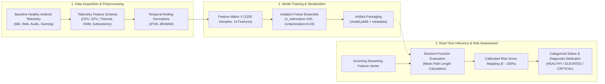

# Machine Learning Pipeline Specification: Isolation Forest Anomaly Detection

**Project:** Android Device Health Prediction AI  

---

## 1. Machine Learning Pipeline Architecture

---

## 2. Mathematical Formulation: Isolation Forest

The fundamental premise of Isolation Forests is that anomalies are 'few and different', meaning they require significantly fewer random splits to isolate within a decision tree than normal instances:

### A. Average Path Length Formulation
The average path length $c(n)$ of unsuccessful searches in a Binary Search Tree (BST) of $n$ instances is given by:

$$c(n) = 2 \ln(n - 1) + 0.5772156649 \text{ (Euler-Mascheroni Constant)} - \frac{2(n - 1)}{n}$$

### B. Anomaly Score $s(x, n)$
For an input feature vector $x$ across an ensemble of $T$ trees, each yielding path length $h_i(x)$:

$$E(h(x)) = \frac{1}{T} \sum_{i=1}^{T} h_i(x)$$

The anomaly score $s \in [0, 1]$ is:

$$s(x, n) = 2^{-\frac{E(h(x))}{c(n)}}$$

- When $E(h(x)) \to 0 \implies s \to 1$: Sample is isolated immediately near the tree root $\implies$ **Definite Anomaly**.
- When $E(h(x)) \to c(n) \implies s \to 0.5$: Sample behaves like typical instances $\implies$ **Normal Baseline**.
- When $E(h(x)) \to n - 1 \implies s \to 0$: Sample requires deep recursive partitioning $\implies$ **Safe Cluster**.
