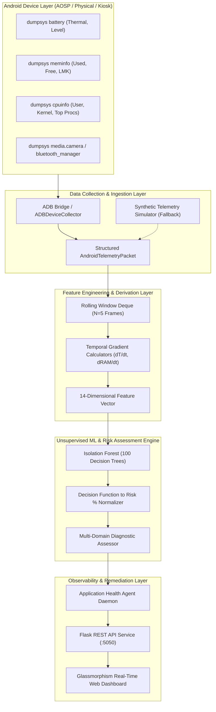

# System Architecture: Android Predictive Device Health AI

**Domain:** Edge AI, Android OS Telemetry, Autonomous Failure Diagnostics  
**Author:** Aravind Reddy ([@DAravindReddy](https://github.com/DAravindReddy))  

---

## 1. Architectural Overview

The **Android Device Health Prediction AI System** monitors operating system dynamics, silicon thermal envelopes, and peripheral subsystems. By coupling low-overhead ADB telemetry collection with an unsupervised Isolation Forest model, the platform detects hardware and software anomalies before fatal kernel panics, thermal shutdowns, or Out-Of-Memory (OOM) app crashes:

