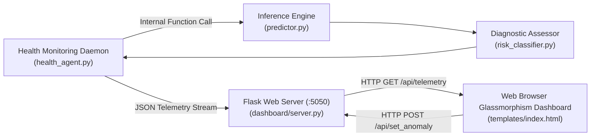

# Technical Documentation: Android Device Health Prediction AI

**Project Name:** `android_device_health_prediction`  
**Target Platform:** Android OS (AOSP / Android 11–14) via ADB / Embedded Agent  
**Author:** Aravind Reddy ([@DAravindReddy](https://github.com/DAravindReddy))  

---

## 1. Android Telemetry Collection Architecture

Real-time telemetry collection operates across physical Android devices via the Android Debug Bridge (ADB) daemon and a deterministic synthetic fallback simulator. Telemetry sampling is orchestrated every 2000 ms, striking a balance between granular observability and minimal host CPU overhead (<1.5% CPU during collection).

---

## 2. ADB and Android System Integration

The telemetry collector (`data_collection/adb_collector.py`) interfaces with core Android OS system services through targeted `dumpsys` sub-commands:

1. **`dumpsys battery`:**
   - Extracts battery temperature (converted from tenths of a degree Celsius to °C), charging status, voltage, and health flags (`BATTERY_HEALTH_GOOD`, `BATTERY_HEALTH_OVERHEAT`).
2. **`dumpsys meminfo`:**
   - Queries the Dalvik/ART virtual machine and native memory allocators.
   - Parses `Total RAM`, `Used RAM`, `Free RAM`, and kernel cached pages.
   - Monitors the Linux Low Memory Killer (`LMK`) to identify processes terminated due to memory pressure.
3. **`dumpsys cpuinfo`:**
   - Computes total CPU utilization as well as the breakdown between userspace processes (`user%`), kernel threads (`kernel%`), and I/O wait (`iowait%`).
   - Identifies the top 4 resource-consuming package names and PIDs.

---

## 3. Subsystem Health Monitoring Domains

### 3.1 CPU and GPU Utilization
- **CPU Monitoring:** Tracks multi-core loads and core frequency throttling across CPU clusters (LITTLE, big, and PRIME cores).
- **GPU Utilization:** Monitors GPU rendering load and frame drop frequency via `surfaceflinger` dumpsys queries.

### 3.2 Thermal Monitoring & Thermal Throttling
- Extracts SoC junction temperatures and battery surface temperatures.
- Tracks thermal governor throttling states:
  - `Level 0 (None)`: Unrestricted frequency scaling.
  - `Level 1 (Light)`: Frame rate capped at 60 Hz.
  - `Level 2 (Moderate)`: Big CPU cores capped at 70% max frequency.
  - `Level 3 (Severe)`: Heavy throttling, Prime core disabled.
  - `Level 4 (Critical)`: Emergency thermal shutdown imminent.

### 3.3 Memory Exhaustion & Leak Detection
- Monitors instantaneous memory utilization percentage.
- Computes the rate-of-change $\frac{d\text{RAM}}{dt}$ (in MB/sec). A sustained positive gradient during static application states flags memory leaks before fatal OOM exceptions crash user applications.

### 3.4 Bluetooth, Camera, and Multimedia Health
- **Bluetooth Subsystem:** Tracks connection drops and transmission retry timeouts via `dumpsys bluetooth_manager`.
- **Camera Subsystem:** Monitors camera HAL surface buffer drops and frame overruns during streaming via `dumpsys media.camera`.
- **Multimedia Codecs:** Detects audio underrun events and hardware video decoder stalls via `dumpsys media.player`.

---

## 4. Feature Extraction & Dataset Preparation

Raw telemetry packets are ingested into `feature_engineering/preprocessor.py` and mapped into a structured 14-dimensional feature vector:

| Index | Feature Name | Dimension / Unit | Physical Significance |
|:---:|---|:---:|---|
| **0** | `cpu_total_pct` | % (0.0 - 100.0) | Aggregate CPU processing pressure |
| **1** | `cpu_user_pct` | % (0.0 - 100.0) | Application execution load |
| **2** | `cpu_kernel_pct` | % (0.0 - 100.0) | System call and context switch overhead |
| **3** | `gpu_util_pct` | % (0.0 - 100.0) | Graphics and rendering load |
| **4** | `soc_temp_c` | °C (20.0 - 100.0)| Silicon junction thermal stress |
| **5** | `battery_temp_c` | °C (20.0 - 65.0) | Electrochemical thermal degradation |
| **6** | `thermal_throttling_level`| Discrete (0 - 4) | Active hardware throttling penalty |
| **7** | `memory_used_pct` | % (0.0 - 100.0) | RAM capacity consumption |
| **8** | `lmk_kill_count` | Integer count | Low Memory Killer terminations |
| **9** | `bluetooth_drops` | Integer count | Wireless stack instability |
| **10**| `camera_dropped_frames` | Integer count | Camera HAL sensor pipeline buffer loss |
| **11**| `media_codec_stalls` | Integer count | Hardware video/audio decoder freezes |
| **12**| `thermal_gradient_c_per_sec` | °C / sec | Thermal acceleration ($\Delta T_{\text{SoC}} / \Delta t$) |
| **13**| `memory_velocity_mb_per_sec` | MB / sec | Memory leak velocity ($\Delta \text{RAM} / \Delta t$) |

---

## 5. Isolation Forest Machine Learning Algorithm

Unlike traditional supervised classifiers that require massive labeled datasets of device failures, the **Isolation Forest** is an unsupervised anomaly detection algorithm based on decision tree ensembles. It operates on the principle that anomalies are rare and exhibit attribute values distinct from normal clusters.

- The model constructs an ensemble of $T = 100$ isolation trees (`iTrees`) by randomly selecting a feature and randomly choosing a split value between the minimum and maximum values of that feature.
- Anomalies require significantly fewer random partitions to isolate, resulting in short average path lengths from the tree root.

---

## 6. Model Training & Anomaly Scoring

1. **Training Protocol:**
   - Trained on 1,200 synthetic baseline vectors representing normal standby, web browsing, background audio, and standard UI interactions.
   - Contamination parameter set to $\alpha = 0.04$ (4% baseline margin).
   - Execution is pinned to single-threaded mode (`n_jobs=1`) for deterministic cross-platform execution.
2. **Decision Score Evaluation:**
   - Evaluates the scikit-learn decision function score $\mathcal{D}(x) \in [-0.5, 0.5]$.
   - Positive scores indicate normal, deep-path cluster membership.
   - Negative scores indicate short-path anomaly isolation.

---

## 7. Risk Scoring Methodology

To provide intuitive telemetry for engineering teams and dashboard operators, raw decision scores are converted into a continuous Risk Percentage:

$$\text{Risk Score (\%)} = \begin{cases}
\max\left(0, \min\left(25, (0.35 - \mathcal{D}(x)) \times 80\right)\right), & \text{if } \mathcal{D}(x) \ge 0.12 \implies \textbf{HEALTHY} \\
25.0 + \left(\frac{0.12 - \mathcal{D}(x)}{0.12}\right) \times 35.0, & \text{if } 0.0 \le \mathcal{D}(x) < 0.12 \implies \textbf{ELEVATED\_RISK} \\
60.0 + \min\left(1.0, \frac{|\mathcal{D}(x)|}{0.25}\right) \times 40.0, & \text{if } \mathcal{D}(x) < 0.0 \implies \textbf{CRITICAL\_ANOMALY}
\end{cases}$$

---

## 8. Communication Between Monitoring Agent, AI Engine & Dashboard

---

## 9. Dashboard and Risk Visualization

The included dashboard provides:
1. Real-time Status Badge (`HEALTHY`, `ELEVATED_RISK`, `CRITICAL_ANOMALY`).
2. Calibrated Device Risk Score % with decision score readout.
3. Chart.js real-time line charts for CPU/RAM load and SoC/Battery thermal curves.
4. Interactive Anomaly Injection Bar for testing thermal overheat, memory leak, CPU spikes, or peripheral stalls with single-click verification.
5. Root-Cause Diagnostic Analysis box displaying specific failure mechanisms and recommended operator remediation actions.
