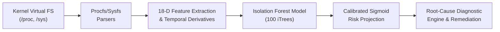

# Linux Device Health Prediction AI

[](LICENSE)
[](PROJECT_STATUS.md)
[](requirements.txt)
[](tests/)

An autonomous, edge-native operating system health prediction service designed for embedded Linux devices, robotics controllers, single-board computers (SBCs), and edge servers.

By coupling low-overhead `/proc` and `/sys` virtual filesystem parsing with an unsupervised 18-dimensional Isolation Forest model and temporal derivative extraction ($\Delta T_{\text{SoC}}/\Delta t$ and $\Delta \text{IRQ}/\Delta t$), the system detects hardware degradation, spurious interrupt storms, thermal runaway, and memory thrashing long before catastrophic kernel crashes occur.

---

## Architecture Overview



---

## Directory Structure

```text
linux_device_health_prediction/
├── README.md                          # Project overview and quickstart
├── PROJECT_STATUS.md                  # Lifecycle status and verification matrix
├── requirements.txt                   # Minimal Python dependencies
├── LICENSE                            # MIT License
├── .gitignore                         # Python/model ignore rules
│
├── kernel_metrics/                    # Low-overhead OS virtual filesystem parsers
│   ├── procfs_parser.py               # /proc/stat, /proc/loadavg, /proc/meminfo
│   └── sysfs_parser.py                # Thermal zones, cooling devices, buses
│
├── telemetry/                         # Telemetry dataclasses and serialization
│   └── schema.py                      # 16-D flat base vector and packet schema
│
├── data_collection/                   # Ingestion and synthetic fault simulator
│   └── linux_collector.py             # Dual native/synthetic stream with 5 fault modes
│
├── feature_engineering/               # Signal conditioning and derivatives
│   └── preprocessor.py                # 18-D vector with ΔT/Δt and ΔIRQ/Δt
│
├── model_training/                    # Training pipeline
│   ├── train.py                       # Fits Isolation Forest (100 trees, n_jobs=1)
│   └── model.joblib                   # Serialized model artifact
│
├── inference_engine/                  # Inference and risk scoring
│   ├── predictor.py                   # Continuous sigmoidal risk projection
│   └── model.joblib                   # Deployed model artifact
│
├── anomaly_detection/                 # Stateful anomaly classification
│   └── detector.py                    # Consecutive anomaly counters & health states
│
├── risk_assessment/                   # Heuristic root-cause analysis
│   └── risk_classifier.py             # Pinpoints culprit subsystem & remediation
│
├── linux_agent/                       # Autonomous background daemon
│   └── daemon.py                      # CLI runner (--demo, --interval, --anomaly)
│
├── dashboard/                         # Real-time web visualization
│   ├── server.py                      # Flask REST API server (port 8082)
│   └── templates/index.html           # Dark-mode glassmorphism UI with Chart.js
│
├── architecture/                      # Architecture and Mermaid diagrams
│   └── system_architecture.md         # Detailed hardware/software pipe-and-filter
│
├── documentation/                     # Production technical manuals
│   ├── technical_documentation.md     # 10 core technical domains explained
│   ├── functional_requirements.md     # Engineering requirements specification
│   ├── software_design.md             # Modular design and API contracts
│   ├── installation_guide.md          # Setup and training instructions
│   ├── user_manual.md                 # CLI and web dashboard manual
│   └── troubleshooting.md             # Diagnostic fault matrix and recovery
│
├── whitepaper/                        # IEEE formal research whitepaper
│   ├── whitepaper.md                  # Complete 13-section IEEE paper
│   ├── problem_statement.md           # Edge failure modes & threshold limitations
│   ├── proposed_solution.md           # Unsupervised ML design pillars
│   ├── methodology.md                 # Mathematical formulation
│   ├── experimental_results.md        # Detection benchmarks across 5 faults
│   └── future_scope.md                # eBPF probing and online learning
│
└── tests/                             # Automated test suite
    └── test_linux_ai.py               # 7 comprehensive unittest suites
```

---

## Quickstart

### 1. Install Dependencies
```bash
pip install -r requirements.txt
```

### 2. Run Automated Verification Demo
```bash
python linux_agent/daemon.py --demo
```

### 3. Run Unit Tests
```bash
python -m unittest tests/test_linux_ai.py
```

### 4. Launch Live Web Dashboard
```bash
python dashboard/server.py
```
Open [http://localhost:8082](http://localhost:8082) in your browser.

---

## Maintainer
**Aravind Reddy**  
Founder & Lead Engineer, Kernelwise Labs  
GitHub: [@DAravindReddy](https://github.com/DAravindReddy)
