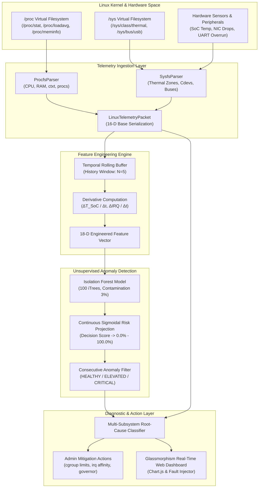

# Linux Device Health Prediction AI - System Architecture

## 1. Architectural Overview

The Linux Device Health Prediction AI architecture is an autonomous edge intelligence service designed to detect subtle, multi-variable operating system anomalies, kernel lockups, and hardware degradation prior to catastrophic system crashes or thermal panics.

The system decouples operating system metric extraction, continuous signal conditioning, unsupervised anomaly scoring, and rule-assisted root-cause diagnosis.

## 2. Ingestion & Preprocessing Subsystems

### 2.1 Virtual Filesystem Sampling
1. **/proc/stat & /proc/loadavg**: Computes user vs. system vs. iowait percentages and context switches per second without incurring heavy userspace overhead.
2. **/proc/meminfo**: Computes resident vs. cached memory, dirty buffers, and swap thrashing rate.
3. **/sys/class/thermal**: Collects physical SoC junction temperatures across discrete thermal zones and records active cooling device governor states.

### 2.2 Feature Vector Mathematical Representation

The 18-dimensional feature vector $\mathbf{x}_t \in \mathbb{R}^{18}$ at timestamp $t$ is formulated as:

$$\mathbf{x}_t = \begin{bmatrix}
\%CPU_{\text{user}}, & \%CPU_{\text{sys}}, & \%CPU_{\text{iowait}}, & Load_{\text{1m}}, & CSW/s, \\
\%RAM_{\text{used}}, & \%Swap_{\text{used}}, & T_{\text{SoC}}, & State_{\text{throttle}}, & IRQ/s, \\
Proc_{\text{run}}, & Proc_{\text{block}}, & Proc_{\text{zombie}}, & Rate_{\text{disk\_w}}, & Drop_{\text{net}}, \\
Err_{\text{uart}}, & \frac{\Delta T_{\text{SoC}}}{\Delta t}, & \frac{\Delta IRQ}{\Delta t}
\end{bmatrix}^T$$

Where:
- $\frac{\Delta T_{\text{SoC}}}{\Delta t} = \frac{T_t - T_{t-1}}{t - t-1}$ represents rate of thermal rise in ${^\circ}\text{C}/\text{sec}$.
- $\frac{\Delta IRQ}{\Delta t} = \frac{IRQ_t - IRQ_{t-1}}{t - t-1}$ represents the acceleration of hardware interrupts in $\text{IRQs}/\text{sec}^2$.
