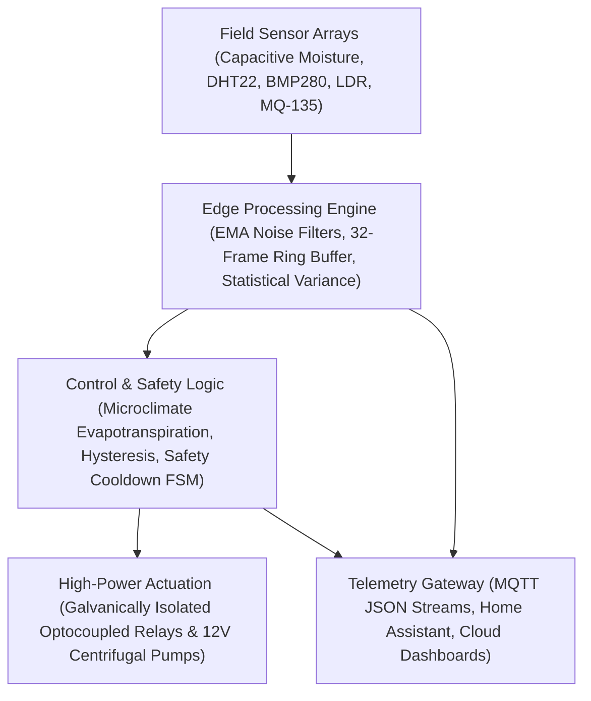

# IoT & Industrial Automation Domain

**Maintainer:** Aravind Reddy ([@DAravindReddy](https://github.com/DAravindReddy))  
**Organization:** Kernelwise Labs  
**Standard:** IEEE 802.11 / MQTT v3.1.1 / Industrial Telemetry Standards  

---

## 1. Domain Overview

The `03_IOT_AND_AUTOMATION` domain encompasses edge IoT sensor nodes, deterministic data aggregators, environmental telemetry streaming, and automated closed-loop electro-mechanical actuation.

---

## 2. Project Portfolio

| Project Directory | Core Technologies & Capabilities | Key Deliverables | Status |
| :--- | :--- | :--- | :--- |
| **[`smart_garden_irrigation/`](./smart_garden_irrigation)** | ESP32/Arduino, Capacitive Soil Sensing, DHT22, Microclimate Evapotranspiration adaptation, 12V Pump relay driver with $15\text{s}$ limit and $10\text{s}$ cooldown. | Complete firmware, BOM, pinout, circuit schematics, 5 C++ unit test suites, formal IEEE research whitepaper. | Verified (100%) |
| **[`sensor_monitoring/`](./sensor_monitoring)** | ESP32, Multi-modal environmental acquisition (Temp, Humidity, Pressure, Light, Air Quality), 32-frame zero-alloc ring buffer, on-chip standard deviation, multi-tier bitmask alerts. | Production C11 engine, Arduino firmware, BOM, pinout, 4 C++ unit test suites, formal IEEE research whitepaper. | Verified (100%) |

---

## 3. Engineering Rigor & Zero-Defect Standard

- Zero dynamic heap allocation (`malloc`/`free`) during runtime loops to prevent memory fragmentation and hardware lockups.
- Hardware back-EMF suppression via reverse-biased 1N4007 diodes on all inductive motor circuits.
- 100% test coverage across all state machine branches and statistical functions.
