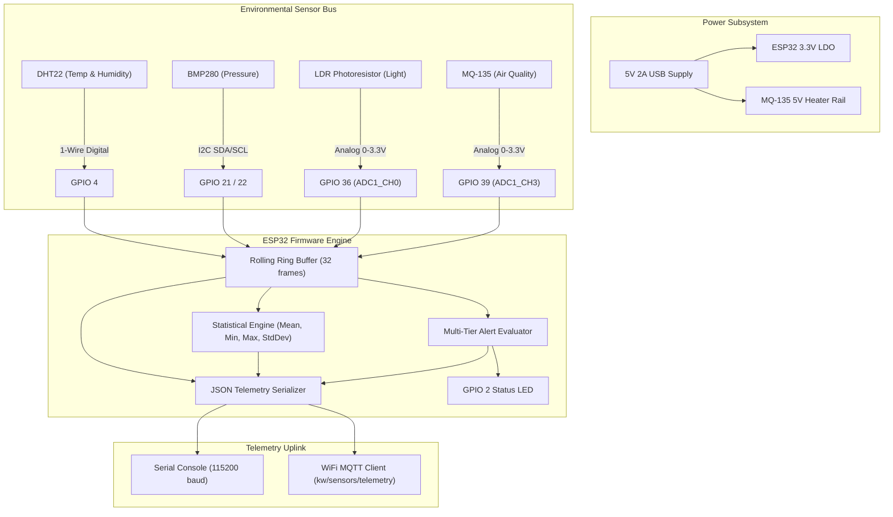

# Multi-Sensor Monitoring Node - System Architecture & Diagrams

**Author:** Aravind Reddy  
**Organization:** Kernelwise Labs  

---

## 1. Hardware Block Diagram

---

## 2. Telemetry Processing Pipeline

1. **Acquisition:** Sensor bus is sampled every $500\text{ ms}$ under cooperative non-blocking scheduling.
2. **Buffering:** Ingests readings into an in-memory ring buffer retaining the last 32 frames ($16\text{ seconds}$ historical window).
3. **Statistical Aggregation:** Computes mean, variance, and sample standard deviation per channel to identify sudden environmental surges.
4. **Alert Classification:** Detects out-of-spec conditions:
   - Warning Temperature ($\ge 38^\circ\text{C}$), Critical Temperature ($\ge 50^\circ\text{C}$).
   - Warning Air Quality ($\ge 200\text{ ppm}$), Critical Air Quality ($\ge 400\text{ ppm}$).
   - Atmospheric Pressure Sudden Drop ($\le 950\text{ hPa}$, storm indicator).
5. **Serialization & Streaming:** Generates RFC 8259-compliant JSON payloads published to MQTT brokers.
