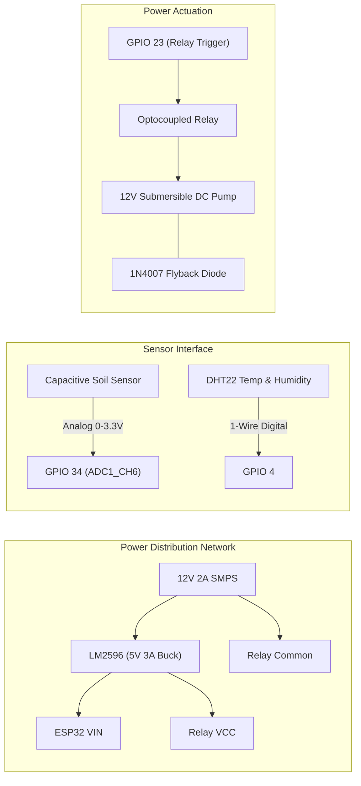
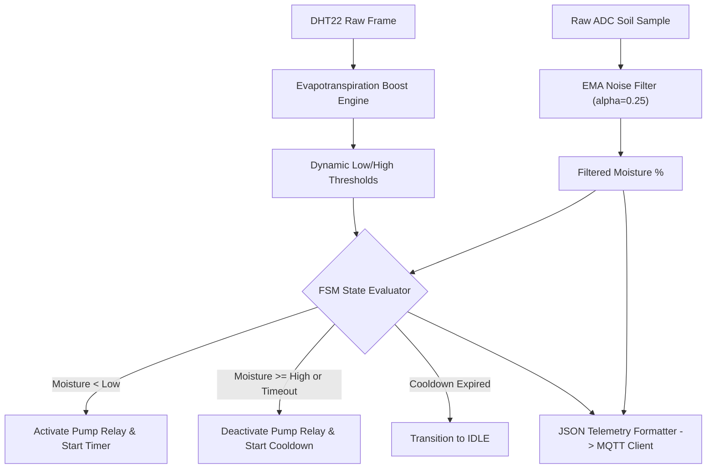

# Smart Garden Irrigation - Architecture Diagrams

**Organization:** Kernelwise Labs  

---

## 1. Hardware Block Diagram



---

## 2. Software Data Flow Diagram



---

## 3. Component Architecture

```
+-------------------------------------------------------------------------------+
|                            IRRIGATION CONTROLLER                              |
+-------------------------------------------------------------------------------+
| 1. Sensor Processing: EMA Filter, ADC Linearizer, Out-of-bounds Detector     |
| 2. Climate Model: Evapotranspiration compensation, threshold adaptation       |
| 3. Safety Watchdog: Max 15s burst limit, 10s soil infiltration cooldown        |
| 4. Actuator Driver: Active-low relay state machine                            |
| 5. Remote Gateway: MQTT JSON telemetry streaming & command dispatcher         |
+-------------------------------------------------------------------------------+
```
