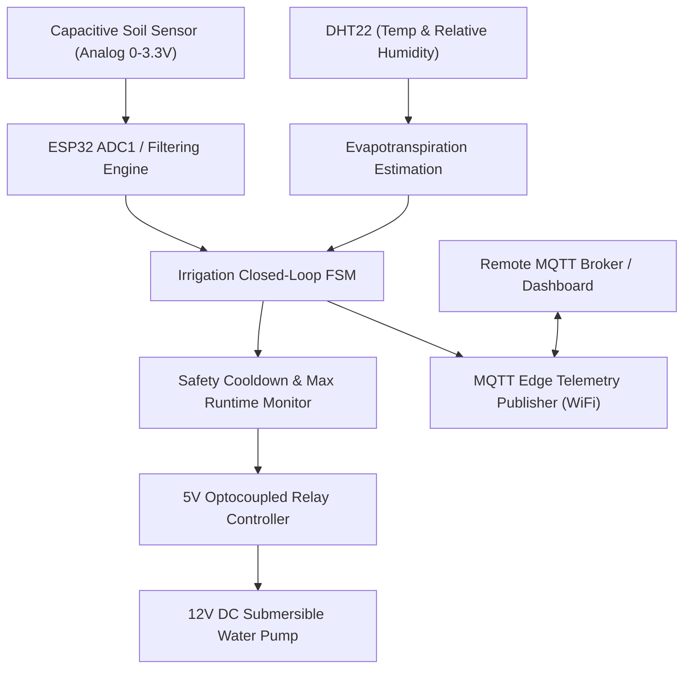

# Smart Garden Irrigation - System Architecture

**Author:** Aravind Reddy  
**Organization:** Kernelwise Labs  

---

## 1. High-Level Architecture Diagram

---

## 2. Core Functional Pipeline

1. **Telemetry Sampling:** ADC samples soil moisture at $4\text{ Hz}$, smoothed using an Exponential Moving Average ($\alpha = 0.25$) to eliminate analog noise.
2. **Adaptive Threshold Adjustment:** Ambient temperature and relative humidity continuously adjust the moisture activation setpoints:
   $$\text{Threshold}_{\text{low}} = 35.0\% + \max(0, (T_{\text{ambient}} - 25.0) \times 0.4) + \max(0, (50.0 - H_{\text{ambient}}) \times 0.15)$$
3. **Finite State Hysteresis Control:**
   - Initiates water delivery when $M_{\text{filtered}} < \text{Threshold}_{\text{low}}$.
   - Sustains watering until $M_{\text{filtered}} \ge \text{Threshold}_{\text{high}}$ or max run duration ($15\text{s}$) expires.
   - Enforces $10\text{s}$ minimum soil infiltration cooldown before the pump can re-engage.
4. **Cloud Telemetry & Overrides:**
   - Publishes JSON telemetry payloads over MQTT every $2\text{ seconds}$.
   - Accepts manual override commands with a fail-safe $30\text{s}$ timeout watchdog.
