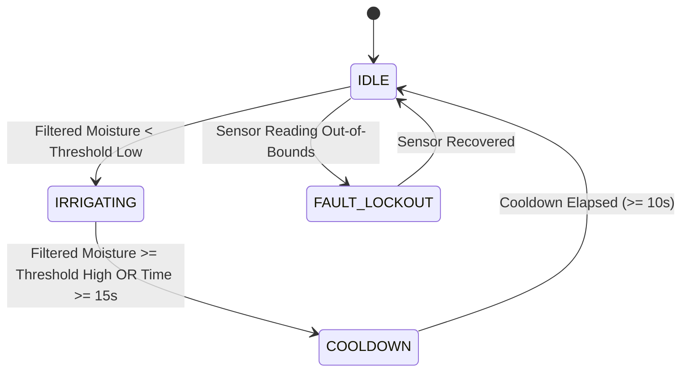

# Smart Garden Irrigation - Technical Documentation

**Author:** Aravind Reddy  
**Organization:** Kernelwise Labs  
**Version:** 1.0.0  

---

## 1. Functional Requirements

1. **Continuous Soil Moisture Monitoring:** Continuously measure volumetric soil water content via corrosion-resistant capacitive sensing.
2. **Ambient Environmental Compensation:** Incorporate ambient air temperature and relative humidity from DHT22 to adjust irrigation setpoints dynamically.
3. **Closed-Loop Hysteresis Irrigation:** Avoid relay chatter by requiring moisture to drop below lower threshold to trigger watering and exceed upper threshold to terminate.
4. **Hardware Safety Protection:** Enforce a hard $15.0\text{s}$ maximum single run duration limit to prevent localized waterlogging or dry pump burnout.
5. **Soil Infiltration Cooldown:** Implement mandatory $10.0\text{s}$ resting period post-irrigation to allow water to percolate through soil root zones before re-evaluating.
6. **Remote Control & Telemetry:** Publish periodic MQTT telemetry ($2\text{s}$ interval) containing moisture, temperature, humidity, and pump status; accept manual overrides with auto-shutoff watchdog ($30\text{s}$).

---

## 2. Software Design & FSM Specifications

---

## 3. Installation & User Manual

### Hardware Assembly
1. Connect capacitive moisture sensor to ESP32 ADC1 pin GPIO34.
2. Connect DHT22 data pin to GPIO4 with a 4.7kΩ pull-up resistor.
3. Wire Relay module input to GPIO23, relay VCC to 5V rail.
4. Wire 12V DC pump in series with relay normally open (NO) contacts, and bridge a 1N4007 diode across pump motor terminals.

### Software Flashing
1. Open `source_code/main/smart_garden_irrigation.ino` in Arduino IDE or VS Code with PlatformIO.
2. Select target board: `ESP32 Dev Module`.
3. Flash firmware at 115200 baud.
4. Monitor serial logs to verify sensor readings and state transitions.

---

## 4. Troubleshooting Guide

| Symptom | Probable Cause | Corrective Action |
| :--- | :--- | :--- |
| Pump activates but water does not flow | Pump air-locked or reservoir empty | Prime pump inlet; verify water level |
| Relay clicks repeatedly (chatter) | Missing hysteresis band or noisy ADC | Verify `threshold_low` and `threshold_high` delta is $\ge 20\%$; check capacitor across sensor rail |
| ESP32 resets when pump activates | Back-EMF spike or voltage drop | Ensure 1N4007 flyback diode is installed; use dedicated 12V SMPS with LM2596 buck converter |
| Moisture reads 0% or 100% constant | Sensor disconnected or corroded | Check ADC pin connection; recalibrate air/water bounds |
