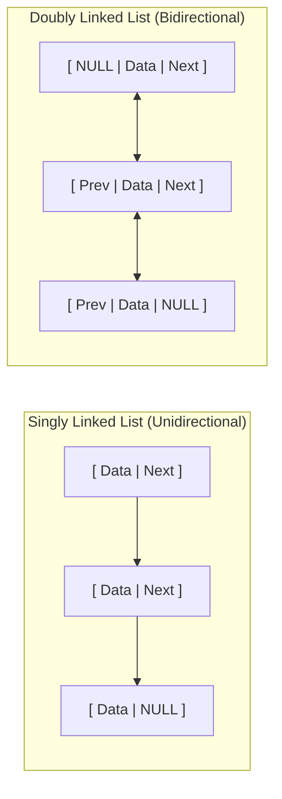

# Core Data Structures Library (C11)

[](README.md)
[](LICENSE)
[](Makefile)

A high-performance, modular library of fundamental data structures written in clean C11 with zero external dependencies. Designed for embedded systems, operating system kernels, and high-throughput low-latency software.

---

## Algorithmic Complexity Summary

| Data Structure | Access | Search | Insertion (Head/Tail) | Deletion (Head/Tail) | Space Complexity |
|:---|:---:|:---:|:---:|:---:|:---:|
| **Singly Linked List (`linkedlist/`)** | $\mathcal{O}(n)$ | $\mathcal{O}(n)$ | $\mathcal{O}(1) / \mathcal{O}(n)$ | $\mathcal{O}(1) / \mathcal{O}(n)$ | $\mathcal{O}(n)$ |
| **Doubly Linked List (`doublelinkedlist/`)**| $\mathcal{O}(n)$ | $\mathcal{O}(n)$ | $\mathcal{O}(1) / \mathcal{O}(1)$ | $\mathcal{O}(1) / \mathcal{O}(1)$ | $\mathcal{O}(n)$ |
| **Array Queue (`queue-DS-array/`)** | $\mathcal{O}(1)$ | $\mathcal{O}(n)$ | $\mathcal{O}(1)$ (Enqueue) | $\mathcal{O}(1)$ (Dequeue) | $\mathcal{O}(n)$ |
| **Circular Queue (`circular-queue/`)** | $\mathcal{O}(1)$ | $\mathcal{O}(n)$ | $\mathcal{O}(1)$ (Enqueue) | $\mathcal{O}(1)$ (Dequeue) | $\mathcal{O}(n)$ |
| **Array Stack (`stack-datastructure/`)** | $\mathcal{O}(1)$ | $\mathcal{O}(n)$ | $\mathcal{O}(1)$ (Push) | $\mathcal{O}(1)$ (Pop) | $\mathcal{O}(n)$ |
| **Linked List Stack (`stack-linkedlist/`)** | $\mathcal{O}(1)$ | $\mathcal{O}(n)$ | $\mathcal{O}(1)$ (Push) | $\mathcal{O}(1)$ (Pop) | $\mathcal{O}(n)$ |

---

## Architectural Visualizations

### 1. Singly vs. Doubly Linked List Topology


### 2. Circular Queue Ring Buffer
```mermaid
graph TD
    subgraph CircularBuffer ["Circular Ring Buffer (Wrap-Around Indexing)"]
        slot0["Slot [0] (Front)"] --> slot1["Slot [1]"]
        slot1 --> slot2["Slot [2]"]
        slot2 --> slot3["Slot [3] (Rear)"]
        slot3 --> slot4["Slot [4]"]
        slot4 -->|Modulo Wrap: (rear + 1) % Capacity| slot0
    end
```

---

## Directory Structure

```text
data_structures/
├── README.md                          # Master overview and complexity reference
├── LICENSE                            # MIT License
│
├── linkedlist/                        # Singly Linked List
│   ├── sl.h                           # Type definitions and function prototypes
│   ├── insert_first.c                 # O(1) Prepend
│   ├── insert_last.c                  # O(n) Append
│   ├── delete_first.c                 # O(1) Pop head
│   ├── delete_last.c                  # O(n) Pop tail
│   ├── delete_list.c                  # Complete memory deallocation
│   ├── find_node.c                    # Linear search by key
│   ├── print_list.c                   # Formatted stdout traversal
│   └── main.c                         # Interactive CLI test harness
│
├── doublelinkedlist/                  # Doubly Linked List
│   ├── dll.h                          # Head & Tail pointer structure
│   ├── insert_first.c                 # O(1) Head insertion
│   ├── insert_last.c                  # O(1) Tail insertion via tail pointer
│   ├── delete_first.c                 # O(1) Head deletion
│   ├── delete_last.c                  # O(1) Tail deletion
│   ├── find_node.c                    # Linear search
│   └── main.c                         # Interactive test runner
│
├── circular-queue/                    # Circular Queue (Ring Buffer)
│   └── array-queue/
│       ├── cqueue.h                   # Capacity, front, rear, and count counters
│       └── main.c                     # Wrap-around verification harness
│
├── queue-DS-array/                    # Linear Dynamic Array Queue
│   ├── queue.h                        # Queue type definition
│   └── def.c                          # Enqueue, dequeue, print, and main driver
│
├── stack-datastructure/               # Array-Backed LIFO Stack
│   ├── stack.h                        # Stack descriptor with top pointer
│   ├── push.c                         # Element push
│   ├── pop.c                          # Element pop
│   ├── peek.c                         # Top element inspection
│   └── main.c                         # Stack driver
│
└── stack-linkedlist/                  # Dynamic Linked-List-Backed Stack
    ├── stacksll.h                     # Stack node definitions
    ├── def.c                          # SLL push/pop/peek implementations
    └── main.c                         # Dynamic stack driver
```

---

## Building and Testing

Each directory can be compiled independently using GCC:

```bash
# Example: Compile and run Singly Linked List
cd linkedlist
gcc -Wall -Wextra -Werror -std=c11 *.c -o sll
./sll
```

---

## Author & Attribution
Original implementations authored by **Aravind Reddy** ([@DAravindReddy](https://github.com/DAravindReddy)).  
Standardized and hardened for Kernelwise Labs portfolio monorepo.
