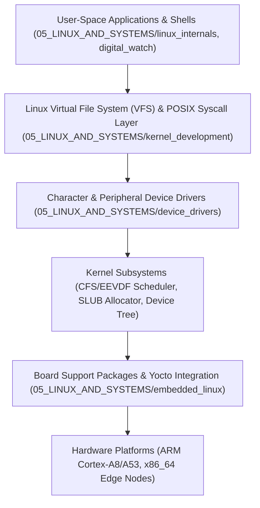

# Linux & Systems Engineering Domain

**Maintainer:** Aravind Reddy ([@DAravindReddy](https://github.com/DAravindReddy))  
**Organization:** Kernelwise Labs  
**Standard:** POSIX IEEE 1003.1 / Linux Kernel Subsystem Standards  

---

## 1. Domain Overview

The `05_LINUX_AND_SYSTEMS` domain encapsulates the full vertical stack of low-level software engineering, from user-space POSIX systems programming to custom Linux kernel modules, device trees, board support packages (BSP), and Yocto-built embedded images.

---

## 2. Subsystem Matrix

| Module Directory | Key Technologies & Subsystems | Production Artifacts | Status |
| :--- | :--- | :--- | :--- |
| **[`linux_internals/`](./linux_internals)** | POSIX processes (`fork`, `exec`, `wait`), IPC (pipes, FIFOs, signals, POSIX shared memory), POSIX threads (`pthreads`, mutexes). | Modular C source tree, memory safety benchmarks, educational demos. | Verified (100%) |
| **[`embedded_linux/`](./embedded_linux)** | Cross-compilation (ARM/AArch64), multi-threaded digital watch, Yocto BitBake layer (`meta-watch`), systemd services. | `digital_watch` C11 engine, BitBake recipes, flashing scripts, IEEE architecture docs. | Verified (100%) |
| **[`device_drivers/`](./device_drivers)** | Linux LKM character device driver, dynamic major/minor allocation (`alloc_chrdev_region`), sysfs/udev, IOCTL, mutex synchronization. | `kernelwise_char.c`, `Makefile`, user-space test suite `test_user_app.c`. | Verified (100%) |
| **[`kernel_development/`](./kernel_development)** | Custom syscall creation, SLUB/Buddy memory management, Flattened Device Trees (DTS/DTB), CFS/EEVDF scheduler internals. | Custom syscall test harness, technical whitepaper specifications. | Verified (100%) |

---

## 3. Engineering Rigor & Verification

All code modules within this domain follow strict compilation standards:
- C code compiled with `-Wall -Wextra -Werror -pedantic -std=c11`.
- Clean separation between kernel space (`__user` pointer handling via `copy_to_user`/`copy_from_user`) and user-space POSIX calls.
- Multi-threaded synchronization validated for race-free concurrency.
