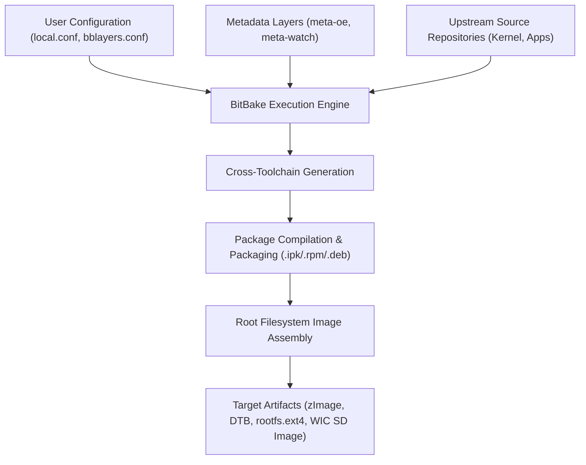

# Yocto Project & OpenEmbedded BitBake Developer Guide

**Author:** Aravind Reddy  
**Organization:** Kernelwise Labs  
**Target Releases:** Kirkstone (LTS 4.0), Scarthgap (LTS 5.0)  

---

## 1. Yocto Architecture & Building Blocks

The Yocto Project is not a Linux distribution; it is a build system framework that generates custom Linux distributions for embedded targets from source code.



---

## 2. Anatomy of a BitBake Recipe

A recipe (`.bb` file) instructs BitBake how to fetch, patch, compile, and package software:

| Variable | Description |
| :--- | :--- |
| `SUMMARY` | Short single-line description of the software package |
| `DESCRIPTION` | Multi-line technical overview |
| `HOMEPAGE` | Upstream repository URL |
| `LICENSE` | Package license identifier (must map to standard SPDX string) |
| `LIC_FILES_CHKSUM` | MD5 or SHA256 checksum of license text in source tree |
| `SRC_URI` | List of source URIs (Git, HTTP, local files) |
| `S` | Path to source directory where files are extracted |
| `D` | Destination directory during `do_install` (simulated target root) |
| `FILES:${PN}` | List of files packaged into the primary target package |

### Standard BitBake Task Execution Flow:
1. `do_fetch`: Retrieves source archives or clones git repositories.
2. `do_unpack`: Unpacks tarballs or patches into `${WORKDIR}`.
3. `do_patch`: Applies custom `.patch` diff files sequentially.
4. `do_configure`: Runs CMake, Autotools (`./configure`), or custom configuration scripts.
5. `do_compile`: Invokes compiler (`make`, `ninja`, `gcc`).
6. `do_install`: Installs binary artifacts, headers, configs into simulated `${D}` root.
7. `do_package`: Segregates binaries, split debug symbols, headers into `.ipk` or `.deb` packages.

---

## 3. Creating Custom Meta Layers

To create a clean layer for embedded software:
```bash
bitbake-layers create-layer meta-watch
bitbake-layers add-layer meta-watch
```

Layer priority dictates recipe override precedence when identical recipes exist across multiple layers.

---

## 4. devtool Rapid Prototyping Workflow

Instead of re-running full BitBake cycles for minor C source modifications:
1. **Extract for modification:**
   ```bash
   devtool modify digital-watch
   ```
2. **Edit code in workspace:**
   ```bash
   cd workspace/sources/digital-watch
   # Edit src/watch_core.c
   ```
3. **Build iteratively:**
   ```bash
   devtool build digital-watch
   ```
4. **Deploy live to target over SSH:**
   ```bash
   devtool deploy-target digital-watch root@192.168.7.2
   ```
5. **Finalize recipe patches:**
   ```bash
   devtool finish digital-watch meta-watch
   ```
