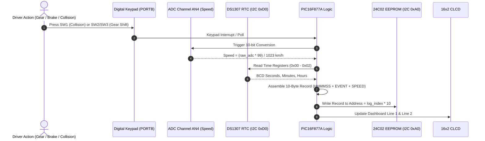

# Data Flow & State Transition Architecture: Car Black Box

**Project:** Automotive Event Data Recorder  

---

## 1. Operating State Hierarchy & Menu Navigation

```mermaid
stateDiagram-v2
    [*] --> DASHBOARD_SCREEN

    state DASHBOARD_SCREEN {
        description: "Default driving view: Displays Time, Gear (GN/GR/G1-G4), and Speed."
    }
    state LOGIN_SCREEN {
        description: "Password prompt: Requires 4-digit PIN. 3 attempts before 60s lockout."
    }
    state MAIN_MENU_SCREEN {
        description: "Operator menu: Select between View, Clear, Download, Password, Time."
    }
    state VIEW_LOG_SCREEN {
        description: "Scrollable circular log viewer (Up to 10 stored events)."
    }
    state DOWNLOAD_LOG_SCREEN {
        description: "Transmits all stored records over UART to PC serial terminal."
    }
    state CLEAR_LOG_SCREEN {
        description: "Resets log count and clears EEPROM pointer index."
    }
    state CHANGE_PASSWORD_SCREEN {
        description: "Re-programs user access credentials in 24C02 EEPROM."
    }
    state SET_TIME_SCREEN {
        description: "Synchronizes DS1307 real-time clock hours and minutes."
    }

    DASHBOARD_SCREEN --> LOGIN_SCREEN : Press SW4 (Enter Menu)
    LOGIN_SCREEN --> DASHBOARD_SCREEN : Timeout (10s) or SW6 Cancel
    LOGIN_SCREEN --> MAIN_MENU_SCREEN : Correct Password Authentication

    MAIN_MENU_SCREEN --> VIEW_LOG_SCREEN : Select "View Log"
    MAIN_MENU_SCREEN --> CLEAR_LOG_SCREEN : Select "Clear Log"
    MAIN_MENU_SCREEN --> DOWNLOAD_LOG_SCREEN : Select "Download Log"
    MAIN_MENU_SCREEN --> CHANGE_PASSWORD_SCREEN : Select "Change Password"
    MAIN_MENU_SCREEN --> SET_TIME_SCREEN : Select "Set Time"
    MAIN_MENU_SCREEN --> DASHBOARD_SCREEN : Press SW6 (Exit)

    VIEW_LOG_SCREEN --> MAIN_MENU_SCREEN : Press SW6 (Back)
    DOWNLOAD_LOG_SCREEN --> MAIN_MENU_SCREEN : Download Complete
    CLEAR_LOG_SCREEN --> MAIN_MENU_SCREEN : Confirmation
    CHANGE_PASSWORD_SCREEN --> MAIN_MENU_SCREEN : Password Saved
    SET_TIME_SCREEN --> MAIN_MENU_SCREEN : Time Updated
```

---

## 2. Event Logging Data Pipeline


