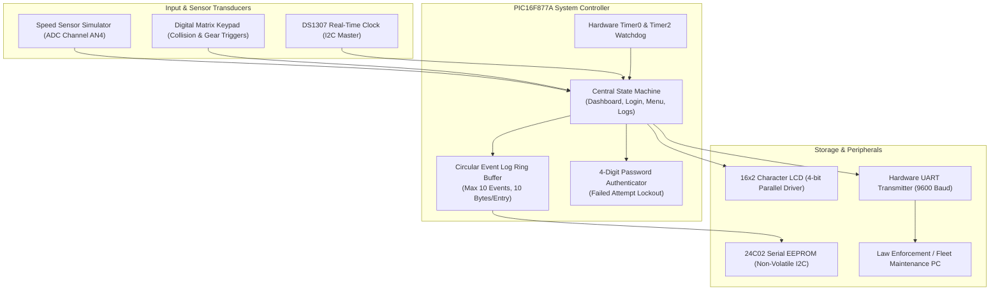

# System Architecture: Automotive Event Data Recorder (Car Black Box)

**Microcontroller:** Microchip PIC16F877A  
**Toolchain:** Microchip MPLAB X IDE / XC8 Compiler  
**Author:** Aravind Reddy ([@DAravindReddy](https://github.com/DAravindReddy))  

---

## 1. Architectural Overview

The **Car Black Box (Automotive Event Data Recorder)** is an embedded telemetry and safety audit platform that continuously records driving events, vehicle speed, and exact timestamps into non-volatile memory:

---

## 2. Event Ingestion & Non-Volatile Serialization

Whenever a driving event occurs—such as shifting gears (`GN`, `GR`, `G1`-`G4`), applying brakes (`BR`), or a sudden deceleration/collision impact (`ON` / `C_`)—the system captures:
1. Exact timestamp (`HH:MM:SS`) from DS1307 RTC registers.
2. 2-character event code (e.g., `"C_"`, `"BR"`, `"G3"`).
3. 2-digit vehicle speed from ADC conversion (`00` to `99` km/h).

Each event is serialized into a 10-byte record:
`[HH][MM][SS][EV][EV][SP][SP]` and committed to the AT24C02 EEPROM at circular address boundaries, ensuring crash survivability even during total vehicular power loss.
