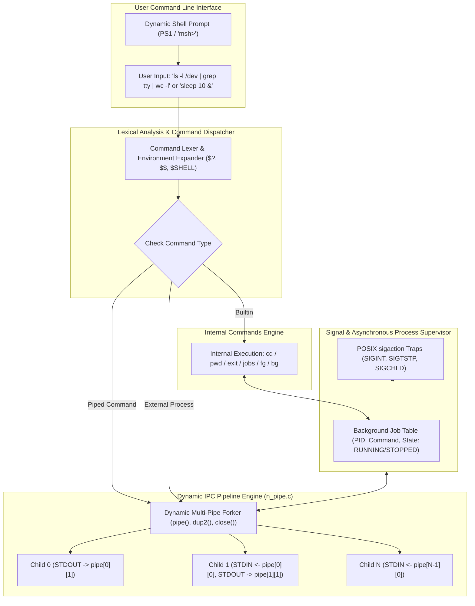

# System Architecture: Linux Minishell (msh)

**Domain:** POSIX Linux System Programming  
**Author:** Aravind Reddy ([@DAravindReddy](https://github.com/DAravindReddy))  

---

## 1. Architectural Overview

**Minishell (`msh`)** is a custom POSIX command interpreter implemented in C. It serves as an operating systems research platform demonstrating process scheduling, POSIX signal handling, asynchronous child harvesting, and arbitrary n-stage inter-process communication (IPC) pipelines:

---

## 2. Dynamic Pipeline IPC Architecture (`n_pipe.c`)

When a user executes a chained command with $N$ pipes (e.g. $K = N + 1$ commands):
1. The shell dynamically allocates $N$ pipe file descriptor pairs: `int pipes[N][2]`.
2. For each command $i \in [0, K-1]$:
   - `fork()` creates a distinct child process.
   - If $i > 0$, `dup2(pipes[i-1][0], STDIN_FILENO)` binds the read end of the previous pipe to standard input.
   - If $i < K-1$, `dup2(pipes[i][1], STDOUT_FILENO)` binds the write end of the current pipe to standard output.
   - All unused pipe descriptors are deterministically closed across all forks to prevent deadlocks and broken pipe errors.
   - Child invokes `execvp()` to overlay the binary image.
3. The parent process closes all its pipe file descriptors and awaits child completion or registers them into the background job table if trailing `&` is detected.
