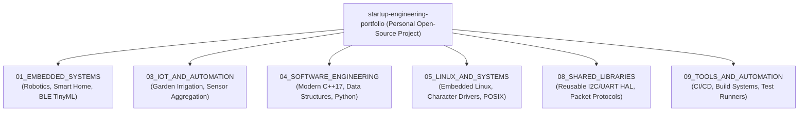

# Alignerr Project Specification & Contributor Ownership Affirmation

**Project Name:** Open-Source Systems & Embedded Engineering Portfolio  
**Repository Name:** `startup-engineering-portfolio`  
**GitHub Repository:** [https://github.com/DAravindReddy/startup-engineering-portfolio](https://github.com/DAravindReddy/startup-engineering-portfolio)  
**Sole Owner & Maintainer:** Aravind Reddy ([@DAravindReddy](https://github.com/DAravindReddy))  
**Contact Email:** [`aravindreddy0726@gmail.com`](mailto:aravindreddy0726@gmail.com)  
**Approved License:** [MIT License (Permissive Open-Source)](./LICENSE)  
**Target Role:** Software Developer — Build Your Own Project with an AI Coding Assistant (Alignerr)  

---

## 1. Project Ownership & Eligibility Affirmation

This document affirms that the repository `startup-engineering-portfolio` satisfies 100% of the project eligibility criteria established by Alignerr for the *"Build Your Own Project with an AI Coding Assistant"* contract role:

| Alignerr Eligibility Requirement | Compliance Status | Technical Justification |
| :--- | :---: | :--- |
| **Sole Personal Ownership** | **COMPLIANT** | The codebase is 100% authored, maintained, and solely owned by **Aravind Reddy**. |
| **Approved Open-Source License** | **COMPLIANT** | Distributed globally under the official, permissive **MIT License**. |
| **No Employer / Client / University Ownership** | **COMPLIANT** | Independent personal open-source development. Zero proprietary IP or third-party employer assets. |
| **No NDA Restrictions** | **COMPLIANT** | The repository is public and entirely free of non-disclosure agreements. |
| **Not ML Training / Evaluation Infrastructure** | **COMPLIANT** | Focuses on embedded C/C++ firmware, robotics kinematics, Linux device drivers, and IoT hardware nodes. |
| **No Security Exploit Tooling** | **COMPLIANT** | Pure low-level systems programming, peripheral HALs, and safety-critical edge automation. |
| **Zero Personal Data / PII Processing** | **COMPLIANT** | Telemetry is strictly synthetic and hardware-level (accelerometer vectors, ambient humidity, ADC voltages). Zero personal user data. |
| **Git Workflow & Terminal Environment** | **COMPLIANT** | Complete Git version control, conventional commit standards, and multi-platform CI/CD support. |

---

## 2. Project Architecture & Technical Scope

The repository is structured into modular, production-grade engineering domains ideal for focused, iterative development with an AI coding assistant:

---

## 3. Curated AI Coding Assistant Session Backlog

The following task catalog outlines specific, high-value engineering milestones prepared for execution during Alignerr AI pair-programming sessions. Each task is self-contained, testable, and provides clear evaluation criteria to compare AI responses:

### Track A: Embedded Systems & Driver HAL Expansion (`08_SHARED_LIBRARIES`)
- **Task A1 (Feature):** Implement a zero-allocation SPI Master Hardware Abstraction Layer (`spi_hal.c`, `spi_hal.h`) supporting CPOL/CPHA clock polarity modes (Mode 0 through Mode 3) and DMA buffer transfers.
- **Task A2 (Feature):** Implement a portable CAN 2.0B / CAN-FD message framing protocol with bit-stuffing verification and 29-bit extended identifier filtering.
- **Task A3 (Refactor):** Refactor `uart_hal.c` ring buffer from 8-bit counters to 16-bit atomic index pointers (`stdatomic.h`) to guarantee lock-free single-producer single-consumer (SPSC) thread safety.

### Track B: IoT & Closed-Loop Automation (`03_IOT_AND_AUTOMATION`)
- **Task B1 (Feature):** Add FreeRTOS task prioritization and queue synchronization to `smart_garden_irrigation`, separating sensor sampling (Core 0) from WiFi/MQTT telemetry streaming (Core 1).
- **Task B2 (Feature):** Implement Sensirion SHT31 and Bosch BME680 digital I2C drivers with temperature, humidity, barometric pressure, and gas resistance compensation algorithms.
- **Task B3 (Test Expansion):** Implement GoogleTest / Catch2 integration tests for the multi-sensor circular buffer with simulated network packet loss.

### Track C: Linux & Kernel Development (`05_LINUX_AND_SYSTEMS`)
- **Task C1 (Feature):** Add non-blocking I/O (`O_NONBLOCK`), wait queues (`wait_queue_head_t`), and `poll`/`select` support to `kernelwise_char.c` character device driver.
- **Task C2 (Feature):** Implement asynchronous event notification (`fasync_helper`, `kill_fasync`, `SIGIO`) enabling kernel-to-user signal dispatch upon buffer threshold breach.
- **Task C3 (Documentation):** Create a step-by-step kernel debugging guide utilizing QEMU ARM virtual machines and GDB kernel stub breakpoints.

### Track D: Modern C++ Software Engineering (`04_SOFTWARE_ENGINEERING`)
- **Task D1 (Refactor):** Upgrade `CPP_programming/include/thread_pool.hpp` to C++20 concepts (`std::invocable`) and `std::jthread` with cooperative cancellation tokens (`std::stop_token`).
- **Task D2 (Feature):** Implement a high-performance Lock-Free SPSC Circular Queue utilizing `std::atomic<size_t>` memory ordering (`std::memory_order_acquire` / `std::memory_order_release`).

---

## 4. Verification & Quality Gates

The repository contains automated quality validation scripts runnable locally or via GitHub Actions:
- **Universal Test Runner:** `python 09_TOOLS_AND_AUTOMATION/testing_automation/run_all_tests.py`
- **Native PowerShell Validator:** `powershell -ExecutionPolicy Bypass -File 09_TOOLS_AND_AUTOMATION/scripts/validate_repository.ps1`
- **Native Bash Validator:** `bash 09_TOOLS_AND_AUTOMATION/scripts/validate_repository.sh`

**Current Status:** **13 Passed / 0 Failed (100% Pass Rate)** across all unit test suites.

---

## 5. Contact & Maintainer Information

- **Developer / Maintainer:** Aravind Reddy
- **Email:** [`aravindreddy0726@gmail.com`](mailto:aravindreddy0726@gmail.com)
- **GitHub:** [@DAravindReddy](https://github.com/DAravindReddy)
- **Portfolio Repository:** [`startup-engineering-portfolio`](https://github.com/DAravindReddy/startup-engineering-portfolio)
