# Startup Engineering Portfolio — Centralized Architecture Repository

[](https://daravindreddy.github.io/startup-engineering-portfolio-/)
[](LICENSE)
[](https://gcc.gnu.org/)
[](https://www.python.org/)
[](09_TOOLS_AND_AUTOMATION)
[]()
[](https://github.com/DAravindReddy)

> **Personal Open-Source Engineering Portfolio & Systems Architecture Repository**  
> **Author & Sole Maintainer:** Aravind Reddy  
> **Contact Email:** [`aravindreddy0726@gmail.com`](mailto:aravindreddy0726@gmail.com)  
> **GitHub Profile:** [https://github.com/DAravindReddy](https://github.com/DAravindReddy)  
> **Live Interactive Portfolio Web App:** [https://daravindreddy.github.io/startup-engineering-portfolio-/](https://daravindreddy.github.io/startup-engineering-portfolio-/)  
> **Contributor Project Spec:** [`ALIGNERR_PROJECT_SPECIFICATION.md`](ALIGNERR_PROJECT_SPECIFICATION.md)  
> **Primary Engineering Domains:** Intelligent Embedded Systems, Linux Kernel & Device Drivers, Industrial IoT, and Systems Programming.

---

## 1. Executive Overview

The **Startup Engineering Portfolio** (`startup-engineering-portfolio`) represents the unified engineering knowledge base, production codebases, and research whitepapers developed across university engineering education, professional embedded industry training, Linux system programming, and independent applied AI research.

Rather than fragmenting projects across disconnected repositories, this monorepo organizes all systems under a rigorous, scalable institutional taxonomy designed to serve as the engineering foundation for a future technology enterprise.

```mermaid
graph TD
    SEP["startup-engineering-portfolio/"]
    
    SEP --> D00["00_STARTUP_DOCUMENTATION<br/>(Vision, Roadmap, Standards)"]
    SEP --> D01["01_EMBEDDED_SYSTEMS<br/>(Smart Home, Robotics, BLE TinyML)"]
    SEP --> D02["02_AI_ML_SYSTEMS<br/>(Android/Linux Predictive Health)"]
    SEP --> D03["03_IOT_AND_AUTOMATION<br/>(Smart Irrigation, Sensor Telemetry)"]
    SEP --> D04["04_SOFTWARE_ENGINEERING<br/>(C, C++, Python, Data Structures)"]
    SEP --> D05["05_LINUX_AND_SYSTEMS<br/>(Embedded Linux, Drivers, Kernel, POSIX)"]
    SEP --> D06["06_EXISTING_GITHUB_PROJECTS<br/>(Preserved & Enhanced Repositories)"]
    SEP --> D07["07_RESEARCH_AND_WHITEPAPERS<br/>(12 Peer-Grade IEEE Research Papers)"]
    SEP --> D08["08_SHARED_LIBRARIES<br/>(Embedded Drivers, Protocols, ML Utils)"]
    SEP --> D09["09_TOOLS_AND_AUTOMATION<br/>(CI/CD, Build Systems, Test Harness)"]
    SEP --> D10["10_TEMPLATES<br/>(Production Scaffolding Templates)"]
```



---

## 2. Interactive Web Application & Live Portfolio

The repository features an interactive web application designed to explore systems, inspect source architecture, run interactive terminal queries, and generate technical proposals.

* **Production URL:** [https://daravindreddy.github.io/startup-engineering-portfolio-/](https://daravindreddy.github.io/startup-engineering-portfolio-/)
* **Continuous Deployment:** Automated via GitHub Actions ([`.github/workflows/deploy-pages.yml`](.github/workflows/deploy-pages.yml)) on every push to `main`.
* **Zero-Server Dependency:** Fully self-contained client-side architecture; can be run offline or by opening [`index.html`](index.html) directly in any browser (`file:///` protocol) without CORS blocks.

### Core Web App Capabilities
* **🌐 Cross-Browser Certified:** Engineered and hardened for Google Chrome, Mozilla Firefox, Apple Safari (macOS & iOS WebKit), Microsoft Edge, and Opera with vendor prefixes, Retina HiDPI canvas scaling, and universal clipboard fallback.
* **🧠 Silicon-to-Cloud Neural Canvas:** Real-time 2D HTML5 canvas visualizer dynamically tracing data flow from bare-metal microcontrollers through Linux kernel drivers and edge AI to cloud telemetry.
* **🤖 Aravind AI Neural Copilot:** Client-side natural language assistant capable of fielding architectural inquiries on RTOS concurrency, TinyML mathematical pipelines, Linux device drivers, and project BOM economics.
* **💻 Cybernetic Terminal Simulator (`KernelOS v3.12-rt`):** Interactive command-line interface with support for `sysinfo`, `uname`, `ls`, `cat`, `verify`, and `clear`.
* **📦 Systems Catalog & Modal Inspector:** Filterable gallery of 21 verified engineering systems with deep-dive technical specs, hardware schematics, and source links.
* **📑 IEEE Research Whitepaper Compendium:** Complete reader for 12 formal IEEE-format whitepapers with 1-click citation export.
* **💼 Automated RFP & Technical Pitch Generator:** Dynamic proposal synthesizer generating tailored enterprise proposals based on industry vertical and project constraints.

#### Local Execution:
```bash
# Direct opening in default browser (Chrome / Edge):
Start-Process index.html

# Or via Python local HTTP server:
python -m http.server 8080
# Navigate to http://localhost:8080
```

---

## 3. Master Project Inventory & Status Matrix

Every project adheres to a strict zero-fabrication mandate: real code, real mathematical models, C++ unit test runners, and publication-grade documentation.

| Directory / Project Name | Domain | Primary Silicon / Languages | Core Functionality | Verification Status |
|---|---|---|---|:---:|
| [`01_EMBEDDED_SYSTEMS/smart_home_automation`](01_EMBEDDED_SYSTEMS/smart_home_automation) | Embedded Systems | Arduino UNO / Embedded C++ / HC-05 | Bluetooth home automation, appliance control, DHT11 sensing, motor/servo actuators, closed-loop soil moisture irrigation. | **Verified (100% Tests Pass)** |
| [`01_EMBEDDED_SYSTEMS/robotics/object_avoiding_robot`](01_EMBEDDED_SYSTEMS/robotics/object_avoiding_robot) | Autonomous Robotics | Arduino UNO / C++ / HC-SR04 / L298N | Autonomous differential-drive obstacle detection, scanning servo sweep, dynamic path avoidance. | **Verified (100% Tests Pass)** |
| [`01_EMBEDDED_SYSTEMS/robotics/fire_fighting_robot`](01_EMBEDDED_SYSTEMS/robotics/fire_fighting_robot) | Emergency Robotics | Arduino UNO / C++ / Flame Array / Pump | Tri-directional flame localization, automated navigation, targeted water extinguishing nozzle. | **Verified (100% Tests Pass)** |
| [`01_EMBEDDED_SYSTEMS/robotics/gesture_controlled_robotic_arm`](01_EMBEDDED_SYSTEMS/robotics/gesture_controlled_robotic_arm) | Kinematic Robotics | Arduino UNO / C++ / MPU6050 / Servos | 4-DOF robotic manipulator, wearable IMU accelerometer gesture mapping, non-blocking PWM positioning. | **Verified (100% Tests Pass)** |
| [`01_EMBEDDED_SYSTEMS/smart_railway_system`](01_EMBEDDED_SYSTEMS/smart_railway_system) | Transportation Safety | Arduino UNO / C++ / Sensors | Track crack detection, ultrasonic obstacle detection, automatic train warning and alarm system. | **Verified (100% Tests Pass)** |
| [`01_EMBEDDED_SYSTEMS/arduino_ble_sense_ai`](01_EMBEDDED_SYSTEMS/arduino_ble_sense_ai) | TinyML Edge AI | Arduino Nano 33 BLE / C++ / BLE 5.0 | 6-axis IMU vibration telemetry, on-device Mahalanobis anomaly scoring, BLE GATT alert broadcasting. | **Verified (100% Tests Pass)** |
| [`02_AI_ML_SYSTEMS/android_device_health_prediction`](02_AI_ML_SYSTEMS/android_device_health_prediction) | Predictive AI / Telemetry | Python 3.12 / scikit-learn / ADB | Real-time ADB Android subsystem telemetry, Isolation Forest anomaly scoring, multi-tier risk classification, glassmorphism dashboard. | **Verified (100% Tests Pass)** |
| [`02_AI_ML_SYSTEMS/linux_device_health_prediction`](02_AI_ML_SYSTEMS/linux_device_health_prediction) | Predictive OS Health | Python 3.12 / Linux / sysfs / procfs | Low-overhead `/proc` and `/sys` kernel telemetry collection, DMA/interrupt monitoring, unsupervised anomaly detection. | **Verified (100% Tests Pass)** |
| [`03_IOT_AND_AUTOMATION/smart_garden_irrigation`](03_IOT_AND_AUTOMATION/smart_garden_irrigation) | Precision IoT | ESP32 / Arduino / C++ / MQTT | Capacitive soil dielectric sensing, microclimate evapotranspiration compensation, hysteresis pump drive, MQTT streaming. | **Verified (100% Tests Pass)** |
| [`03_IOT_AND_AUTOMATION/sensor_monitoring`](03_IOT_AND_AUTOMATION/sensor_monitoring) | Environmental IoT | ESP32 / Arduino / C11 / I2C | 5-channel telemetry aggregation (Temp, Humidity, Pressure, Light, Air Quality), 32-frame ring buffer, on-chip standard deviation. | **Verified (100% Tests Pass)** |
| [`04_SOFTWARE_ENGINEERING/CPP_programming`](04_SOFTWARE_ENGINEERING/CPP_programming) | Modern C++ | C++17 / ThreadPool / RAII | RAII scoped resources, thread-safe asynchronous ThreadPool task queue with `std::future`, STL algorithm benchmarks. | **Verified (100% Tests Pass)** |
| [`04_SOFTWARE_ENGINEERING/data_structures`](04_SOFTWARE_ENGINEERING/data_structures) | Computer Science | C11 / GCC / Make | High-performance Singly Linked Lists, Doubly Linked Lists, Circular Queue Ring Buffers, Stacks with memory leak audits. | **Completed & Audited** |
| [`04_SOFTWARE_ENGINEERING/C_programming`](04_SOFTWARE_ENGINEERING/C_programming) | Systems Foundations | C11 / Pointers / Bitwise | Bitwise manipulation, pointers, file I/O, user-defined types (UDT), storage classes. | **Completed & Audited** |
| [`04_SOFTWARE_ENGINEERING/python_programming`](04_SOFTWARE_ENGINEERING/python_programming) | Software Engineering | Python 3.12 / Modular | 23 modular assignments covering algorithms, OOP, file processing, and system scripts. | **Completed & Audited** |
| [`05_LINUX_AND_SYSTEMS/embedded_linux`](05_LINUX_AND_SYSTEMS/embedded_linux) | Embedded Linux / BSP | ARM / Yocto / C11 / systemd | Multi-threaded Digital Watch C11 engine, custom Yocto BitBake layer (`meta-watch`), systemd services, U-Boot guide. | **Verified (100% Tests Pass)** |
| [`05_LINUX_AND_SYSTEMS/device_drivers`](05_LINUX_AND_SYSTEMS/device_drivers) | Kernel Driver | Linux 5.x/6.x LKM / C / IOCTL | Character device driver, dynamic major/minor (`alloc_chrdev_region`), sysfs/udev auto-nodes, mutex safety, user test app. | **Verified (100% Tests Pass)** |
| [`05_LINUX_AND_SYSTEMS/kernel_development`](05_LINUX_AND_SYSTEMS/kernel_development) | Kernel Architecture | Linux Kernel / DTS / Syscalls | Custom syscall implementation, SLUB/Buddy memory layout, Device Tree bindings, CFS/EEVDF scheduler internals. | **Completed & Documented** |
| [`05_LINUX_AND_SYSTEMS/linux_internals`](05_LINUX_AND_SYSTEMS/linux_internals) | Systems Programming | C / POSIX / System Calls | Process trees (`fork`/`exec`), I/O redirection (`dup2`), IPC pipelines (`pipe`, FIFO, `shm`), asynchronous signals (`sigaction`). | **Completed & Audited** |
| [`06_EXISTING_GITHUB_PROJECTS/imported_projects/Car_black_box`](06_EXISTING_GITHUB_PROJECTS/imported_projects/Car_black_box) | Automotive Embedded | PIC16F877A / MPLAB XC8 / Embedded C | Automotive event logger, DS1307 RTC timestamping, 24C02 EEPROM non-volatile storage, CLCD display, ADC speedometer. | **Completed & Preserved** |
| [`06_EXISTING_GITHUB_PROJECTS/imported_projects/minishell`](06_EXISTING_GITHUB_PROJECTS/imported_projects/minishell) | Systems Programming | C / POSIX / Linux | Custom Unix command interpreter (`msh`), dynamic multi-stage pipes (`n_pipe`), signal trapping (Ctrl+C, Ctrl+Z), job control (`fg`, `bg`). | **Completed & Preserved** |
| [`06_EXISTING_GITHUB_PROJECTS/imported_projects/Addressbook`](06_EXISTING_GITHUB_PROJECTS/imported_projects/Addressbook) | C Programming | C11 / Structs / File I/O | Modular contact storage, cross-platform `stdio_ext.h` fallback wrapper, dynamic memory allocation. | **Completed & Preserved** |

---

## 4. Research Whitepaper Compendium

All research papers adhere to the formal 13-section IEEE transactions schema with full mathematical modeling and BOM economics. Access the complete index at [`07_RESEARCH_AND_WHITEPAPERS/README.md`](07_RESEARCH_AND_WHITEPAPERS/README.md):
1. **KW-WP-01:** *Deterministic Cooperative Multitasking and Hysteresis Closed-Loop Automation*
2. **KW-WP-02:** *Safety-Critical Telemetry Acquisition and Non-Volatile Crash Data Logging*
3. **KW-WP-03:** *POSIX Process Orchestration and Asynchronous Pipeline Execution*
4. **KW-WP-04:** *Edge-Assisted Anomaly Detection and Predictive Health Modeling for Android*
5. **KW-WP-05:** *Kernel-Level Telemetry Ingestion and Unsupervised Anomaly Detection for Linux*
6. **KW-WP-06:** *Autonomous Ultrasonic Reactive Navigation and Servo Turret Kinematics*
7. **KW-WP-07:** *Optical Flame Triangulation and Autonomous Closed-Loop Fire Suppression*
8. **KW-WP-08:** *Inertial Gesture Teleoperation and Inverse Kinematic Mapping for 4-DOF Manipulators*
9. **KW-WP-09:** *Autonomous Rail Crack Detection and Automated Level Crossing Collision Avoidance*
10. **KW-WP-10:** *Edge Machine Health Monitoring via TinyML Mahalanobis Anomaly Detection*
11. **KW-WP-11:** *Autonomous Closed-Loop Irrigation Automation via Microclimate Compensation*
12. **KW-WP-12:** *Deterministic Edge Multi-Sensor Aggregation and Statistical Environmental Anomaly Telemetry*

---

## 5. Master Repository Structure

```text
startup-engineering-portfolio/
│
├── README.md                          # Master repository README
├── index.html                         # Interactive Web App & Portfolio entry point
├── styles.css                         # Cyberpunk/glassmorphism design system & responsive layout
├── app.js                             # Core UI engine, Neural Canvas, Terminal & AI Copilot
├── projects-data.js                   # Master dataset (21 verified systems & 12 whitepapers)
├── LICENSE                            # Root MIT License
├── CONTRIBUTING.md                    # Git flow, conventional commits, code review policies
├── CODE_OF_CONDUCT.md                 # Contributor Covenant Code of Conduct
├── SECURITY.md                        # Vulnerability disclosure and SLA policies
├── .gitignore                         # Universal ignore rules (C, Python, Arduino, OS)
├── .editorconfig                      # Universal code indentation and formatting standard
│
├── .github/                           # CI/CD Workflows
│   └── workflows/
│       ├── ci.yml                     # GitHub Actions Matrix CI (GCC, Clang, Python 3.10-3.12)
│       └── deploy-pages.yml           # Automated GitHub Pages continuous deployment
│
├── 00_STARTUP_DOCUMENTATION/          # Strategic blueprints, roadmaps, and guidelines
│   ├── startup_vision.md
│   ├── engineering_standards.md
│   ├── development_roadmap.md
│   ├── technology_stack.md
│   └── repository_guidelines.md
│
├── 01_EMBEDDED_SYSTEMS/               # Embedded microcontrollers & robotics
│   ├── smart_home_automation/
│   ├── robotics/
│   │   ├── object_avoiding_robot/
│   │   ├── fire_fighting_robot/
│   │   └── gesture_controlled_robotic_arm/
│   ├── smart_railway_system/
│   └── arduino_ble_sense_ai/
│
├── 02_AI_ML_SYSTEMS/                  # Telemetry AI & anomaly detection
│   ├── android_device_health_prediction/
│   ├── linux_device_health_prediction/
│   └── predictive_maintenance/
│
├── 03_IOT_AND_AUTOMATION/             # Environmental sensing & edge control
│   ├── smart_garden_irrigation/
│   └── sensor_monitoring/
│
├── 04_SOFTWARE_ENGINEERING/           # Computer science foundations
│   ├── C_programming/
│   ├── CPP_programming/
│   ├── python_programming/
│   └── data_structures/
│
├── 05_LINUX_AND_SYSTEMS/              # Systems programming & kernel modules
│   ├── linux_internals/
│   ├── embedded_linux/
│   ├── kernel_development/
│   └── device_drivers/
│
├── 06_EXISTING_GITHUB_PROJECTS/       # Historical preserved & documented repositories
│   └── imported_projects/
│       ├── Addressbook/
│       ├── Car_black_box/
│       └── minishell/
│
├── 07_RESEARCH_AND_WHITEPAPERS/       # Consolidated formal research papers (12 IEEE Papers)
│   ├── README.md
│   └── LICENSE
│
├── 08_SHARED_LIBRARIES/               # Reusable HAL, protocols, and ML helpers
│   ├── common_embedded_drivers/
│   ├── sensor_libraries/
│   ├── communication_protocols/
│   └── ml_utilities/
│
├── 09_TOOLS_AND_AUTOMATION/           # Cross-cutting scripts and CI workflows
│   ├── scripts/
│   │   ├── validate_repository.ps1
│   │   └── validate_repository.sh
│   ├── testing_automation/
│   │   └── run_all_tests.py
│   └── github_workflows/
│       └── ci.yml
│
└── 10_TEMPLATES/                      # Production boilerplate scaffolding
    ├── embedded_project_template/
    ├── ai_ml_project_template/
    ├── linux_project_template/
    └── robotics_project_template/
```

---

## 6. Universal Validation & Automated Testing

A single unified test runner executes the 13 verification suites across C11, C++14, C++17, and Python 3.12:

```bash
# Cross-Platform Python Test Runner:
python 09_TOOLS_AND_AUTOMATION/testing_automation/run_all_tests.py

# Windows Native PowerShell:
powershell -ExecutionPolicy Bypass -File 09_TOOLS_AND_AUTOMATION\scripts\validate_repository.ps1

# Linux / macOS Native Bash:
bash 09_TOOLS_AND_AUTOMATION/scripts/validate_repository.sh
```

**Quality Gate Guarantee:**
```
=====================================================================
 Kernelwise Labs: Monorepo Multi-Language Test Runner                
 Root: C:\Users\aravi\startup-engineering-portfolio
=====================================================================
[RUNNING] Shared C Libraries (i2c, uart, dht11, packet)      ... PASS
[RUNNING] Smart Home Automation Test Suite (C++)             ... PASS
[RUNNING] Object Avoiding Robot Test Suite (C++)             ... PASS
[RUNNING] Fire Fighting Robot Test Suite (C++)               ... PASS
[RUNNING] Gesture Controlled Robotic Arm Test Suite (C++)    ... PASS
[RUNNING] Smart Railway Track System Test Suite (C++)        ... PASS
[RUNNING] TinyML Arduino BLE Sense AI Test Suite (C++)       ... PASS
[RUNNING] Smart Garden Irrigation Test Suite (C++)           ... PASS
[RUNNING] Multi-Sensor Monitoring Test Suite (C++)           ... PASS
[RUNNING] Embedded Linux Digital Watch Test Suite (C11)      ... PASS
[RUNNING] Modern C++17 Core Suite                            ... PASS
[RUNNING] Android Device Health Prediction (Python)          ... PASS
[RUNNING] Linux Device Health Prediction (Python)            ... PASS
=====================================================================
SUMMARY: 13 Passed, 0 Failed
=====================================================================
```

---

## 7. Author & Contributor Attribution
 
* **Author & Sole Owner:** **Aravind Reddy**
* **Contact Email:** [`aravindreddy0726@gmail.com`](mailto:aravindreddy0726@gmail.com)
* **GitHub Profile:** [@DAravindReddy](https://github.com/DAravindReddy)
* **License:** [MIT License (Permissive Open-Source)](LICENSE)
* **Project Specifications for AI Coding Sessions:** See [`ALIGNERR_PROJECT_SPECIFICATION.md`](ALIGNERR_PROJECT_SPECIFICATION.md)
